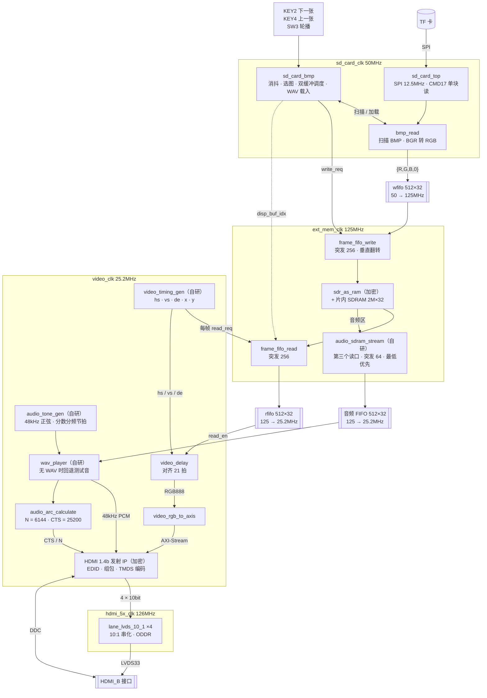

# 系统架构与数据通路

> 对应代码：**`v0.1-baseline`**（官方 lab_ex5 原样）+ 第 3 步的复位改造与握手同步（见第五节、第二节跨域表、第七节）。之后改了结构要同步更新本文。
> 用途：读懂代码 → 设计报告"系统组成及功能说明"的素材 → 答辩。
> 数据来源：源码 + TD 6.2.1 编译报告（`*_Runs/phy_1/final_timing.rpt`、`*_phy.area`）。

---

## 一、总框图



一句话：**TF 卡里的 BMP 经 SPI 读出 → 写进 SDRAM 的后台缓冲 → 视频时序每帧从前台缓冲读一整帧 → 和音频一起交给 HDMI IP 编码 → 串化后从 HDMI_B 发出。**
**音频：开机时把 TF 卡里的 WAV 整段载入 SDRAM 音频区，之后由第三个读口循环读出、按 48kHz 送进 HDMI IP；没有 WAV 时回退片内测试音。**

---

## 二、时钟域

### 第三周 OSD 叠加

`video_timing_gen` 的 `x/y` 经 21 拍 `video_coord_delay` 与 `video_delay` 的 `de/rgb` 对齐。像素流先经过 `video_color_adjust`，再通过 `video_osd_overlay`；状态栏位于顶部 512×80 区域，四行中文直接标注图片、播放模式、亮度等级、对比度等级、特效档位、字幕混合强度、音量百分比、源尺寸、缩放方式、当前操作、转场效果，以及**运行时间戳**（第 4 行 `运行 HH:MM:SS` 与系统自检行每 4 秒交替：顶层 `uptime_div` 把 25.2MHz 分频成秒脉冲，六个 BCD 计数器走 时:分:秒、99 小时循环，打包成 `uptime_bcd` 进 OSD，帧边界锁存；这是官方扩展要求(1) 点名的动态文字，板卡没有 RTC，所以显示运行时长而不是墙上时钟）。中间一行显示“音量 0/35/70/100%”，旧配置恢复的档位 3 显示 75%；音量变化在帧边界锁存，缩略图模式中也会更新。状态栏使用固定深色背景与高对比度文字，所需汉字由 `scripts/gen_osd_chinese_font.py` 从 Noto Sans SC 生成 16×16 固定点阵（含时间戳、特效档位和自检行要用的字），不依赖运行时字体。**点阵存在 eRAM ROM 里**：脚本产出“汉字码 → 7 位字形索引”的小 case 表（几十个 LUT）和 `status_font_rom`（2048×16bit，地址 = {索引[6:0], 行[3:0]}，`initial` 常量 + `ram_style = bram`，综合成 4 块 9Kb BRAM）。ROM 是同步读，所以整块 OSD 层多一拍流水：地址由当前像素坐标组合产生、数据下一拍回来，面板/四行中文/底部字幕一起右移 1 像素，内部相对位置不变。这一改把状态栏字库从上千个 LUT 常量换成块 RAM：同种子对比 LUT 16436 → 15128、slice 4754 → 4405，`video_clk` 域余量 从 +1.3ns 升到 **+12.19ns**（字库那棵大 mux 树原本就是视频域的拥塞源）。底部字幕仍在 640 像素整行滚动，由 5×7 点阵组合 ROM 生成，青色前景由矩阵键 S5/S6/S7/S8 选择 0/35/70/100% 混合；0% 即关闭字幕。字幕每帧向左移动 1 像素，左侧离开后从右侧进入，640 帧完成一圈；内容中的 `PICn` 和 `A/M` 跟随当前图片及播放模式变化。滚动位置、调色参数与播放状态只在场同步开始时更新，避免帧内变化。SW2 控制状态栏显示。

### 实时亮度与对比度

KEY3 依次选择正常、亮度、对比度模式；在调节模式中 KEY2/KEY4 分别增减所选参数，并阻断同一按键传向 SD 播放控制。正常模式中 KEY2/KEY4 分别切换下一张/上一张。退出调节模式时需先松开两键，防止误切图。亮度五档对应 RGB 每通道偏移 -48/-24/0/+24/+48；对比度五档围绕 128 缩放为 0.5/0.75/1/1.25/1.5 倍，最终结果限制在 0~255。默认档均为 2，像素保持原样。转场改由矩阵键 S9~S12 直接选择，图片也能用 S13~S16 按编号直接跳，KEY1 短按在正常播放时不再切转场；SW2 控制状态栏，SW3 上拨自动播放、下拨手动播放，SW4 上拨演示模式、下拨正常播放。矩阵键 S1/S2/S3/S4 选择音量 0/35/70/100%，S5/S6/S7/S8 选择字幕混合 0/35/70/100%。按键与拨码在相应时钟域消抖/同步，调色参数在帧边界锁存。OSD 用中文显示“亮度等级”“对比度等级”的档位和当前操作，并在编辑时强制显示，保证用户始终知道按键作用。字幕和状态栏在调色之后叠加，文字颜色不随整体亮度变化。

SW4 上拨进入自动演示模式，下拨回到正常播放。`osd_controls` 在视频时钟域对 SW4 做两级同步，检测到 0→1 时保存转场、亮度和对比度，检测到 1→0 时恢复，演示期间屏蔽两个切图按键。演示状态经 `sync_2ff` 进入 SD 域，临时与 SW3 的自动播放电平合成有效轮播状态，WAV 节拍和无 WAV 定时换图都使用该状态；下拨后仍按 SW3 位置决定手动/自动播放。顶层比较同步后的显示缓冲编号，只在真正切换到下一帧时给演示控制一拍；演示模式依次轮换四种转场并循环调整亮度、对比度，不改变 WAV 的音频节拍或 SD 读取时序。OSD 播放字段显示“演示”，便于现场展示时确认模式。仿真：`tb_osd_controls`、`tb_video_osd`、`tb_wav_load`。

### W25Q64 参数固化

板载 W25Q64 是独立于 FPGA 上电配置 Flash 的 8 MB 数据 Flash。手册第 17 页给出 CS=P8、SDO=N8、WP=P9、HOLD=R9、SCLK=M9、SDI=P7；`pin.adc` 按此约束。`config_flash_journal` 复用完赛资料中的标准 SPI 驱动，在末尾两个 4 KB 扇区 `0x7FE000` 和 `0x7FF000` 交替写入 12 字节记录。每条记录带 32 位版本、亮度/对比度/转场值、格式标记和 CRC16；启动时读两槽并选最新有效版本，空白或非法记录回退到 `2/2/淡入`。写入时先擦目标槽，再编程和回读校验；掉电中断时旧槽仍可恢复。

`parameter_persistence` 在视频时钟域启动读取；读取完成之前按键不改变播放状态。用户最后一次调节后静默约 500 ms 才写入，连续调节重新计时；自动演示改变的临时值不保存。保存状态机在后台运行，不暂停 HDMI、WAV 或 TF 读取。Flash 错误时保留当前 RAM 参数，不会对同一组参数无限重复擦写；下次手动调整可再次尝试。仿真：`tb_config_journal`、`tb_parameter_persistence`、`tb_osd_controls`。

音量档位也随上述参数保存。新记录将音量 `0..4` 编成 `1..5` 放在原记录未用的 `period[9:6]`，旧记录该字段为 `0` 时按满音量 `4` 恢复；CRC 和双槽版本规则不变。矩阵键选用档位 `0/1/2/4`，分别对应约 0/35/70/100%；旧记录中的档位 `3` 仍按 75% 播放。

状态栏和字幕中的图片序号来自 `sd_card_bmp.img_idx`，而不是双缓冲编号；自动/手动状态来自 SW3 电平与演示模式合成的有效播放状态。两者经过 2FF 同步到像素时钟域。仿真：`tb_video_osd`、`tb_video_osd_scroll`、`tb_video_color_adjust`、`tb_osd_controls`、`tb_osd_alignment`、`tb_wav_load`。

### 第四周转场

`video_transition` 位于 `video_delay` 与 `video_color_adjust` 之间，只处理图片像素，字幕/状态栏后叠加。WAV 载入后无论自动轮播是否开启，`sd_card_bmp` 都准备下一张；四图常驻模式优先复用已写好的 bank。KEY2 的消抖脉冲若早于下一张就绪，像素域先保留旧图并暂存请求；下一张就绪后才进行 16 帧淡出，全黑后一拍翻转 `manual_next_toggle`，`sd_card_bmp` 同步后按一次切图请求处理。长 WAV 双缓冲模式切到第 4 张后才能复用另一块缓冲预读第 1 张；1280×960 BMP 约 3.7MB，在 25MHz SPI 下纯传输至少约 1.18 秒。四图常驻模式在首轮载入第 1 张后不再有这段等待。若后台始终无法就绪，等 240 帧后回退到原有切图超时路径，避免请求永久挂起。新读缓冲编号同步回像素域后，可淡入、从左右方向揭示，或从中心向四角作菱形溶解。溶解档以屏幕中心为原点，曼哈顿距离阈值每帧增加 24 像素，边缘 32 像素带使用 4×4 有序抖动逐像素显现，第 24 帧完全显示。仅遮罩单张新图，不增加帧缓冲或 SD 读取带宽。自动轮播保留原音频节拍，缓冲编号变化后启动揭示。消隐期已确认的新缓冲可在下一有效帧开始揭示；帧内变化保持黑色直至帧边界。若等待切图超过 240 帧，转场恢复旧画面，避免永久黑屏。

单读口只提供当前图像素，无法在同一帧同时取得旧/新两张图。因此左/右揭示是从黑色背景显示新图，并非两幅图同时平移。转场由矩阵键选择：S9 淡入、S10 左揭示、S11 右揭示、S12 菱形溶解（一键直达，`matrix_press_pulse[11:8]` 进 `osd_controls` 的 `effect_select`）；浏览模式下这些键被忽略，状态栏直接显示对应中文效果。仿真：`tb_video_transition`、`tb_osd_controls`、`tb_wav_load`。

### 第五周音频可视化

WAV 已就绪时备用测试音暂停相位与音符计数，WAV 不可用时从暂停处恢复；双色 LED 可视化持续输出，屏幕上的波形和频段计算照常进行。SD 卡控制器只在无 WAV 的定时轮播模式运行 1 秒计数器，WAV 节拍切图不再使它空转。这些都是寄存器使能，不门控 PLL 时钟；实际功耗收益需板级测量。此前优化前后 TD 资源为 LUT 13,544→13,503、寄存器 6,057→6,068，视频域余量 +1.453→+1.649ns，SD 域 +0.396→+0.673ns（布局结果同时包含位置变化，不等同于功耗数据）。

数码管扫描、译码与 SW1 视图切换现已移除，原共享引脚只输出双色 LED 信号。此前包含数码管的布线数据（LUT 13,380、寄存器 6,077，视频域 +4.653ns，SD 域 +0.020ns）仅作历史记录；RTL 修改后必须重新布线才可判断资源和时序。

`audio_visualizer` 与 HDMI 发送链共用 `audio_valid` 和左声道 16 位 PCM，在 `video_clk` 域每 25 个样本抽取 1 个、每帧采 32 点，并用双缓冲在帧边界提交波形。三组有符号移位低通及其差分形成 4 个粗频段：`LO`（约 120Hz 以下）、`LM`（约 120–480Hz）、`HM`（约 480Hz–2.2kHz）、`HI`（约 2.2kHz 以上）。这是一阶滤波近似，不是频率精确分隔的 FFT。原实现用无符号拼接表达式算术右移，负差值不能正确衰减，且固定阈值让演示 WAV 的高频柱 644/720 帧低于最低档。修复符号运算后，对四段峰值分别做 ×2/×2/×4/×8 饱和增益，屏幕柱高、标签和 LED 共享帧锁存值。像素链路顺序为图片转场 → 画面特效 → 亮度/对比度 → 字幕/状态栏 → 音频可视化，柱标签和波形区域均与底部滚动字幕不重叠。

`audio_sample_gain` 使用默认音量档位、W25Q64 恢复的档位或矩阵键 S1-S4 选择的档位处理 48 kHz 样本。35% 和 70% 采用 8 位定点增益，实际分别约为 35.16% 和 69.92%。手动和自动图片转场都不改变背景音乐幅度或 `audio_valid`，以保持连续听感与原音画节拍。最终立体声 PCM 经过有符号增益后同时送 HDMI 与屏幕音频可视化。仿真：`tb_audio_sample_gain`、`tb_video_transition`、`tb_parameter_persistence`。

同一组 PCM 帧峰值驱动四个频段各两颗双色 LED：每组第一颗使用完整峰值，第二颗使用减去 24 的峰值；5 位 PWM 将能量映射为亮度，红绿占空比组合成绿、黄绿、橙、红。低频两段能量相对上一帧增加超过阈值时，单颗红色高亮依次扫过 8 颗灯，每帧前进一步，随后有 10 帧触发冷却；每次起音还使各组配色轮换。板载 LED 是红绿双色，不支持蓝色等 RGB 全彩色。PWM 在 25.2MHz 视频域工作，32 拍一个周期，LED 控制信号经两级同步进入 50MHz 引脚域。红色引脚为 `led_red8[7:0]`，绿色引脚为 `led_green8[7:0]`；原引脚位置不变，板上 SW6 需拨到 LED 物理档。SW1 不再参与 FPGA 控制。`sim/analyze_visualizer_levels.py` 可对任意 48kHz/16-bit 立体声 WAV 打印四段帧峰值；旧的 LED 档位分布仅适用于阈值版逻辑。原 12 秒平滑和弦只检测出 4 次明显低频起音；新 `assets/scale_demo/05_demo_beat.wav` 保持相同 FPGA 音频格式，在和弦上叠加 120 BPM 鼓点，离线分析检测到 24 次低频起音，用于板上可视化演示。仿真：`tb_audio_visualizer`、`tb_osd_controls`。

4 颗独立绿色 LED1~LED4 对应 FPGA A4/A3/C10/B12，高电平点亮，不占用双色 LED 的引脚。`auto_breathe_led` 在自动播放且首图有效时给四灯同一个 PWM（约 1.54kHz）；WAV 模式用 `av_sync` 已计算的每图样本数作为分母，每个实际送出的音频样本推进相位，亮度在一个图片区间内完成暗→亮→暗一次，实际显示缓冲切换时重置。无 WAV 的定时轮播用 60 个视频帧完成一轮，读卡超过一秒时保持熄灭直至切图；手动模式始终熄灭。相位推进与音画节拍共用样本依据，不修改原自动切图时序。仿真：`tb_auto_breathe_led`、`tb_av_sync`、`tb_av_chain`。

TD 界面曾在保存工程时用旧文件列表覆盖 `.al`，导致新增模块被当成黑盒。`audio_visualizer` 的定义随已注册的 `video_osd_overlay.v` 编译；`bmp_scale_2x` 的定义随已注册的 `SD/sd_card_bmp.v` 编译。两者不再需要单独的 TD 文件项。

### 收尾阶段：画面特效与系统自检上屏

像素链路顺序更新为 **图片转场 → 画面特效 → 亮度/对比度 → 字幕/状态栏 → 音频可视化**。`video_effects` 挂在 `video_transition` 与 `video_color_adjust` 之间，是纯逐像素运算，只作用于图片层，OSD 文字和底部字幕不受影响，也不碰 SDRAM 域。KEY3 的编辑链因此变成“正常 → 亮度 → 对比度 → 特效 → 正常”（`edit_mode` 0~3），KEY2/KEY4 在特效档上加/减一档（0~6，帧边界锁存），状态栏第 3 行显示“操作 特效 等级 N”。

| 档位 | 效果 | 实现 |
|---|---|---|
| 0 | 关闭 | 直通 |
| 1 | 灰度 | BT.601 矩阵 77/150/29（系数和恰好 256，不会溢出） |
| 2 | 反色 | 按位取反 |
| 3 | 棕褐 | 3×3 矩阵 101/197/48、89/176/43、70/137/34（/256）；R/G 两行系数和大于 256，用 9 位高位判断饱和到 255 |
| 4 | 左右镜像 | 2×640×24 eRAM 行缓存乒乓（写地址 639-x、读地址 x） |
| 5 | 上下分屏 | 下半屏（y≥240）走灰度，用于分屏对比 |
| 6 | 色调分离 | 每通道只留高 3 位 |

灰度与棕褐两组 3×3 矩阵的乘法器用 TD 的 `(* dsp_style = "yes" *)` 约束指定落到 DSP 上：布线后 DSP 从 7 个用到 15 个（共 29 个），像素矩阵吃掉了原本闲置的 DSP，也把上百个 LUT 的乘法器让了出来。

左右镜像用一块 2×640×24 的行缓存（`mirror_line`，`ram_style = bram`）：**本行倒着写**（写地址 639-x_q），**同时从另一个 bank 正着读**（读地址 x），读出来的正好是上一行的镜像像素，读写永远落在不同 bank，行尾（`de && x==639`）翻转 bank。整屏像素都来自同一行（上一行），不会在屏幕中间留下两行接缝；整幅画面于是只差一行缓存，不需要整帧缓存。读地址直接用输入的像素坐标 x，行缓存的同步读延迟正好和唯一一级流水对齐，所以整块特效只有一拍流水（图片层相对 OSD 右移 1 像素、下移 1 行，静止画面看不出差别）。

> **为什么不做 90° 旋转**：整帧旋转需要缓存一整帧 640×480×24bit = 7.37Mbit，而 EG4S20 全部 BRAM 只有 64×9Kb ≈ 0.58Mbit（当前已用 37 块），纯像素域放不下。要做得改数据通路——读卡时多写一份转置副本到 SDRAM 备用区，或把 SDRAM 读地址改成转置顺序（按列读会破坏页局部性，125MHz 读口带宽吃紧）。本轮明确不做，避免“画面上有、实际卡顿”的假功能。

系统自检行接在状态栏第 4 行：顶层 `uptime_div` 的秒脉冲同时推进 `diag_phase`，`diag_phase[2]` 让第 4 行在**运行时间戳**与**自检行**之间每 4 秒交替：

```
自检 V A S 帧 PP 读图 PP 秒 缓存 PP 欠载 PP
```

- V / A / S：视频 / 音频 / 存储健康标志取反（1 = 正常），来源是原有的 `health` 粘滞标志（音频位同时覆盖 WAV FIFO 取空与 SDRAM 音频读口异常）；
- 帧 PP：`fps_count` 每帧加一、每秒锁存，按帧边界计数，不受 OSD 刷新影响；
- 读图 PP 秒、缓存 PP：SD 域的 `diag_seconds` / `diag_hits` 经两级同步进视频域后在帧边界锁存；
- 欠载 PP：`wav_player` 的 8 位饱和 FIFO 取空计数直接从视频域引入。

串口里原本要看的 `PIC/AUTO/WAV/BRI/CON/ERR/BEAT/VOL/LD/HIT/TIME`，现在屏幕上都有对照，现场演示不用接串口，也把“工程规范性”写在明面上。字库相应扩到 128 个字模：`status_font_rom` 从 1024×16 改成 2048×16（eRAM 2→4 块），新增 自/检/特/效/帧/读/秒/缓/存/欠/载 11 个字模，仍由 `scripts/gen_osd_chinese_font.py` 生成；自检行的两位数用一次常数乘（`value*205>>11`）取十位、`clamped - tens*10` 取个位，没有除法器。仿真：`tb_video_effects`（含镜像逐列核对）、`tb_video_osd`（时间戳行 + 自检行 + 欠载数字）、`tb_video_osd_remote`、`tb_video_osd_scroll`、`tb_osd_controls`（编辑链 0~3 与特效档位 0~6 饱和）。

本轮顺带修掉两个一直卡着的收尾项：`tb_thumbnail_downsample` / `tb_thumbnail_downsample_full` / `tb_thumbnail_stream_unpack` 三个仿真缺 `.f` 源文件列表，`sim/run.sh` 找不到 DUT；顶层 `key1_short_*` 三个同步寄存器声明写在首次使用之后（正是第七节记的“TD 会把前向引用的逻辑剪掉”那个坑），ModelSim 连 `tb_uart_status` 都编译不过——把声明上移到 `always` 块之前后，全仓 40 个 testbench 全部 `ALL PASSED`。

### USB1 串口状态输出

板卡手册第 11 页确认 USB1 CH340 Type-C 串口连接 FPGA `TXD=D12`、`RXD=F12`。本设计仅使用 TXD；RXD 未映射为顶层端口，任何串口输入都不会触发控制。

串口报文现在由 **`uart_slim_reporter`（约 80 LUT + 一条 `uart_tx_byte`）** 发送，仍然只发不收。

运行中每 60 帧输出一行 190 字节可读状态：

```
UPTIME=01:02:03 IMAGE=2/4 AUTO_MODE=ON TF_CARD=READY WAV_AUDIO=READY \
BRIGHTNESS_LEVEL=2 CONTRAST_LEVEL=2 VOLUME_LEVEL=4 TRANSITION=FADE \
PLAYLIST_ERRORS=0 LOAD_PHASE=READY HEALTH=0\r\n
```

事件日志不再经串口导出；同一模块按 `newest_slot` 读取最近 7 个槽，展开成
`log_view` 供 OSD LOG 页显示。串口只发不收，电脑端
`scripts/uart_status_monitor.py` 只读取并打印状态行。仿真 `tb_uart_slim_reporter`
逐字节比对 **190 字节状态行**并检查日志快照刷新；`tb_config_event_log`
覆盖序号、坏槽、满环与重启。

### 第五周图片缩放

TF 卡扫描识别 320×180、320×240、640×480 和 1280×960 的 24 位未压缩、正高度 BMP。`bmp_read` 解析宽高，帧写请求握手时 `bmp_scale_2x` 锁存缩放模式。640×480 原样透传；320×240 在两个 320 像素行缓存间轮换，每个像素输出两次、每行输出两遍，形成 640×480 最近邻帧。320×180 沿用相同的水平 2 倍复制，垂直方向每 3 个源行依次输出 2、3、3 行，非等比拉伸成 640×480。现有 `frame_fifo_write` 再将 BMP 的底行先存储顺序翻正，SDRAM 始终只接收固定 307200 像素帧。WAV 数据旁路缩放器。单个源像素输入要求间隔至少 8 个 100MHz 周期；板上 SD SPI 25MHz 读取 24 位像素至少约 96 周期，因此双行缓存不会被连续读卡覆盖。缩放源数据送完、缩放输出完成且 SDRAM 写完后三个条件都满足，才切换显示缓冲。其它尺寸不被扫描注册；尚不支持任意分辨率适配。仿真：`tb_bmp_scale_2x`、`tb_wav_load`（混合尺寸和原有 WAV/轮播回归）；`scripts/check_tf_image.py` 与 FPGA 扫描条件一致。

逻辑优化后，缩放器将原先两个分散的 320×24 行数组改成一块 640×24 同钟双端口缓存，写端和读端各用同步地址；第二行的地址是 `320 + x`，不能直接拼接 bank 位（320 不是 2 的幂）。TD 将它推断为 3 块 BRAM，缩放模块 LUT 约 3729→78；全工程资源从 LUT 13,544 / 寄存器 6,057 / BRAM 23 变成 LUT 9,837 / 寄存器 5,791 / BRAM 26。`tb_bmp_scale_full` 逐像素覆盖完整 640×480 的 320×240 放大及 320×180 拉伸。资源节约和动态功耗降低不是等价指标，后者仍需实测。

1280×960 输入在 `bmp_read` 中按源行/列计数只输出偶数行的偶数列像素，直接形成 640×480 像素流；帧写入器仍负责 BMP 的垂直翻转。该模式不需要全屏随机 SDRAM 读取，也不增加行缓存。`scripts/make_large_bmp.py` 可以把普通照片裁剪为 4:3 的 1280×960 BMP，或用 `--size 320x180` 裁剪为 16:9 的演示图。当前支持上述四种尺寸，不宣称任意分辨率适配。

显示尺寸标签由 `sd_card_bmp` 在图片加载握手时记录待提交的尺寸档，并仅在 `disp_buf_idx/img_idx` 实际切换时更新 `display_scale_mode`；WAV 加载和预加载均不改变当前显示档。该两位状态同步到像素时钟域后在帧边界锁存。顶部 OSD 第二行显示源尺寸和缩放模式（320×180 为 `ST`）；底部保留简短的动态滚动字幕。官方选题只要求不同分辨率图片适配 HDMI 输出，没有规定必须保持宽高比；320×180 图片按屏幕比例拉伸铺满。

所有 PLL 的参考时钟都是板载 50MHz 晶振（R7）。

| 时钟 | 频率 | 来源 | 驱动什么 | 扇出 |
|---|---|---|---|---|
| `clk` | 50MHz | 晶振 R7 | PLL 参考、双色 LED 引脚同步 | 32 |
| `sd_card_clk` | **50MHz** | sys_pll C0（VCO 1000 ÷ 20，第 7 步改） | TF 卡读取、BMP 解析、选图控制 | 494 |
| `ext_mem_clk` | 125MHz | sys_pll C1（÷ 8，0°） | SDRAM 控制器、帧缓存读写调度 | 457 |
| `Clk_sft` | 125MHz ∠180° | sys_pll C2（÷ 8，180°） | SDRAM 芯片时钟 | 1 |
| `video_clk` | **25.200MHz** | video_pll C0（VCO 630 ÷ 25） | 视频时序、HDMI IP、音频、ACR、音画同步 | 1442 |
| `hdmi_5x_clk` | 126MHz | video_pll C1（VCO 630 ÷ 5） | TMDS 串化（DDR，每通道 252Mbps） | 30 |

- **PLL 已用 2/4**。第 5 步删掉了官方的音频 PLL（PLL_HDMI_AUDIO，只用了它 12.295MHz 一路），音频改在 video_clk 下分频产生，空出 2 个 PLL 留给后续（例如 720p）
- **帧率 60.000Hz**（第 6b 步）：像素时钟 25.2MHz ÷ (800 × 525) = 60.000Hz 整。VESA 标称 25.175MHz、容差 ±0.5%，25.2MHz 偏 +0.1%。第 6b 步之前是 25.000MHz → 59.52Hz
- **video_pll 的配置**：50MHz ÷ 5 = 10MHz 鉴相 × 63 = VCO 630MHz，**No compensation 反馈模式（VCO 直接反馈）**。Normal 模式经 C0 反馈时要做出 25.2MHz 得输入分频 125（鉴相 0.4MHz），IP 向导不接受，会自动退回 25.000MHz。No compensation 不补偿时钟树延迟，video_clk 与输入时钟之间相位不确定，所以 SDC 把视频时钟和其他时钟设为异步组（见第七节）
- **sys_pll 的配置**：50MHz ÷ 1 = 50MHz 鉴相 × 1，**C0 外反馈（`CLKC0_EXT`）**，C0 = 50MHz；VCO = C0 × 20 = 1000MHz，C1/C2 = VCO ÷ 8 = 125MHz（C2 再移 180°）。第 7 步只把 C0 从"VCO ÷ 10 = 100MHz"改成"VCO ÷ 20 = 50MHz"：SD 域时序预算 10 → 20ns，VCO 与 SDRAM 侧完全不动
- 顶层 `PIX_HZ` 参数必须和 video_pll C0 一致：48kHz 节拍分频、音画同步提前量、误差显示的 0.1ms 换算都从它推出

### 跨时钟域怎么过的

| 信号 | 方向 | 同步方式 | 评价 |
|---|---|---|---|
| 像素数据 | 50 → 125MHz | 异步 FIFO `wfifo` | ✅ |
| 像素数据 | 125 → 25.2MHz | 异步 FIFO `rfifo` | ✅ |
| `write_req` | 50 → 125MHz | 3 级打拍 | ✅ |
| `write_req_ack` | 125 → 50MHz | `sync_2ff` 2 级同步（第 3 步加；原来没有同步，见第七节） | ✅ |
| `read_req` | 25.2 → 125MHz | 3 级打拍 | ✅ |
| `read_req_ack` | 125 → 25.2MHz | `sync_2ff` 2 级同步（第 3 步加；原来没有同步） | ✅ |
| 复位 | 50MHz → 各域 | `rst_sync` 异步置位、同步撤销（第 3 步加） | ✅ |
| `write_finish` | 125 → 50MHz | 单拍脉冲转翻转电平 + 3 级打拍 + 边沿检测 | ✅ 标准做法 |
| `disp_buf_idx` / `write_buf_idx` | 50 → 125MHz | 2 级打拍（2 位总线） | ✅ 每次只变 1 位 |
| `display_valid` | 50 → 25.2MHz | `sync_2ff`（第 6b 步加；官方原来直接当组合逻辑用） | ✅ |
| ~~I2S 三根线~~ | ~~12.295 → 25MHz~~ | 第 5 步删除：音频直接在 video_clk 域产生，没有跨域 | — |
| TMDS 10 位 | 25.2 → 126MHz | 翻转检测 + 固定时刻装载 | ✅ 两时钟同一 PLL，相位固定 |

---

## 三、图像通路（逐级）

### 1. TF 卡 → 字节流

[sd_card_top.v](../user_source/hdl_source/SD/sd_card_top.v) = `spi_master` + `sd_card_cmd` + `sd_card_sec_read_write`

- SPI 模式。初始化用 100kHz（50MHz ÷ 500），之后切到 **12.5MHz**（50MHz ÷ 4）
- 每次用 **CMD17 单块读**一个扇区（512 字节），没有用 CMD18 多块连读
- 一张图 921,654 字节 = 1801 个扇区。纯传输时间下限 ≈ 0.3s，加上每个扇区的命令开销更长

### 2. 扫描与解析

[bmp_read.v](../user_source/hdl_source/SD/bmp_read.v) 有两种工作模式：

| 模式 | 什么时候 | 做什么 |
|---|---|---|
| 扫描 | 上电、SD 卡初始化完成后一次 | 从扇区 0 开始识别四种受支持尺寸的 24 位 BMP；找到首张后暂停让它先显示，再从原位置继续找余下 BMP 和 WAV。最多记 4 张；BMP 排在 WAV 前面时，遇到 WAV 即结束扫描，找不到 WAV 时仍有 64MB 上限 |
| 加载 | 每次切图 | 再读一次文件头复核 → 和帧缓存握手 → 跳过前 `pixel_offset`（54）字节 → 每 3 字节拼成一个像素 |

**BGR → RGB 在这里完成**：BMP 每个像素按 B、G、R 顺序存，依次写进 `bmp_data[7:0]`、`[15:8]`、`[23:16]`，于是 `bmp_data = {R, G, B}`。送给 FIFO 的是 `{R, G, B, 8'h00}`（32 位）。

**热复位卡死（官方代码的 bug，第 3 步已修）**

板上现象：连续按 KEY1 后数码管停在 `0`，重新下载也不行，只能断电。官方原版同样复现。
仿真（[sim/tb_sd_reinit.v](../sim/tb_sd_reinit.v) + 卡模型 [sim/models/sd_card_model.v](../sim/models/sd_card_model.v)）查明的过程：

1. 复位发生在卡正在发一个扇区时。FPGA 复位了，**卡没断电**，还剩几百字节没发完，期间不理任何命令
2. 主机重新初始化。`sd_card_cmd` 在**命令字节还没发完时就开始检查应答**，把卡残留的数据字节 `0x01` 当成了 CMD0、CMD8 的应答
3. 卡其实从没收到这些命令，初始化"成功"是假的。之后 ACMD41 一直失败，`sd_card_sec_read_write` 只会回 CMD55 重试，永远不回 CMD0

修复，三层：

| 层 | 文件 | 做法 |
|---|---|---|
| 根因 | `sd_card_cmd.v` | 新增 `S_FLUSH`：初始化前先读到连续 2600 个 `0xFF`，把卡没发完的数据清干净；命令 6 字节发完后才检查应答，最多等 64 字节 |
| 不再死循环 | `sd_card_sec_read_write.v` | CMD8 / CMD16 出错回 CMD0 重来；`sd_init_done` 等 CMD16 成功才置 1 |
| 兜底 | `sd_card_top.v` | 看门狗：初始化 2s、读一个扇区 250ms 没完成，就复位 SD 三个模块重来（覆盖拔卡） |
| 加载保护 | `sd_card_bmp.v`、`bmp_read.v` | 移植 lab_ex4：一张图 3s 没加载完就放弃；写完脉冲先于源结束也不丢 |

另外 `pin.adc` 给 `sd_miso` 开了内部上拉，没插卡时读到稳定的 `0xFF`。

**限制**：
- 宽高必须正好 640×480（直接比较文件头）
- **没有处理行尾 4 字节对齐**。640 × 3 = 1920 刚好是 4 的倍数，所以不需要；换别的宽度就会斜
- 扫描假设文件在卡上是连续存放的

### 3. 写 FIFO → 写 SDRAM

[frame_read_write.v](../user_source/hdl_source/SD/frame_read_write.v) 里的 `wfifo_32_32_512`（512 深，预读模式）+ [frame_fifo_write.v](../user_source/hdl_source/SD/frame_fifo_write.v)

- FIFO 里攒够 256 个字（或剩下的数据已经全到），且读通道不在突发 → 发起一次 **256 字的突发写**
- **垂直翻转**：BMP 从最下面一行开始存。写地址从 `基址 + 479 × 640` 开始，每写完 640 个像素地址回退 `2 × 640 − 1 = 1279`。这样存进 SDRAM 的图已经是正的，读的时候顺序读即可

### 4. SDRAM 帧缓存

[sdram.v](../user_source/hdl_source/SD/sdram.v) = `sdr_as_ram`（加密控制器，自动初始化和刷新）+ `EG_PHY_SDRAM_2M_32`（芯片内合封的 SDRAM 裸片，不占外部引脚）

- 用户接口：21 位**字地址**、32 位数据；读写互斥，**写优先**
- 每个像素占一个 32 位字，RGB 在 `[31:8]`

| 区域 | 字地址 | 大小 |
|---|---|---|
| BUF0 | 0 ~ 307,199 | 1.17MB |
| BUF1 | 307,200 ~ 614,399 | 1.17MB |
| BUF2、BUF3（四图常驻模式） | 614,400 ~ 1,228,799 | 各 307,200 字，首次加载后常驻 |
| **音频区**（四图常驻） | 1,228,800 ~ 1,943,551 | 714,752 字，48kHz 立体声约 **14.89 秒** |
| **音频区**（长 WAV 双缓冲） | 614,400 ~ 1,943,551 | 1,329,152 字，48kHz 立体声约 **27.69 秒** |
| **高清缩略图区** | 1,943,552 ~ 2,097,151 | 153,600 字，四格各 320×240 RGB565，每字两个像素 |

`sd_card_bmp` 在扫描完成后按 WAV 的实际载入字数选择模式：能放在 BUF2/BUF3 后面时，图片 0~3 各写自己的 bank，音频写到 1,228,800；否则保持 BUF0/BUF1 轮换，音频从 614,400 开始。首次图像在扫描前仍写 BUF0，首图损坏而从其它图片恢复时沿用双缓冲。图像 bank 2/3 与 bank 0/1 一样垂直翻转，WAV 写入始终线性。四图模式只有第一次访问某张图会读 TF 卡，之后手动和音乐节拍切换都复用已完成的整帧；无 WAV 的定时轮播也复用缓存。两种模式都在帧边界提交显示缓冲，坏图仍按原有重试/跳过规则处理。

图片扫描完成后，SD 控制器在后台按图片编号额外读取尚未生成预览的 BMP，优先处理正常播放和 WAV 加载。预览经现有缩放器统一成 640×480，再隔行隔列采样、打包为 RGB565。原写 FIFO 按 256 字突发写入四宫格对应地址，并翻转 BMP 底行先存的顺序。每格写完才显示高清像素；未完成时保持深色空位，不再显示低分辨率缓存。浏览模式的帧读 FIFO 每帧读 153,600 字，像素域拆成 307,200 个显示像素。预览区与两种音频区均不重叠。

历史编译记录：四图常驻与串口诊断版 TD（布局种子 4）资源为 LUT 16,435/19,600、寄存器 9,988/19,600、BRAM 26/64；100MHz SD 域 setup 余量 +0.227ns，25.2MHz 视频域 +5.061ns。这是删除 USB1 接收命令之前的结果，不能作为当前版本的时序结论。当前版本仅保留串口状态输出，新增设计仍需查看最新布局布线报告并上板检查。

带宽：普通显示读取 307,200 字 × 60 帧/s ≈ 74MB/s；浏览模式读取 153,600 字 × 60 帧/s ≈ 37MB/s。音频读 48,000 字/s = 0.19MB/s。SDRAM 峰值为 125MHz × 4 字节 = 500MB/s；实际还受刷新、突发间隙与写入仲裁影响。

### 5. SDRAM → 读 FIFO

[frame_fifo_read.v](../user_source/hdl_source/SD/frame_fifo_read.v) + `rfifo_32_32_512`（512 深，普通模式，读出延迟 1 拍）

- 每帧场同步开始时，`video_timing_gen` 发出 `read_req`
- `frame_fifo_read` 收到后：清空 rfifo → **锁存此刻 `disp_buf_idx` 对应的基地址** → 只要 rfifo 空位 ≥ 256 就突发读 256 字，直到读满一帧
- **换缓冲只在帧开始时生效，所以切图不撕裂**

### 6. 视频时序 + 对齐

**[video_timing_gen.v](../user_source/hdl_source/video/video_timing_gen.v)（第 4 步自研，替换官方 `color_bar` + `video_timing_data`）**

- 时序参数在顶层定义一次，同时传给本模块和 HDMI 发射 IP：

| | 有效 | 前沿 | 同步 | 后沿 | 总计 | 极性 |
|---|---|---|---|---|---|---|
| 行（像素） | 640 | 16 | 96 | 48 | 800 | 负 |
| 场（行） | 480 | 10 | 2 | 33 | 525 | 负 |

- 一行按 有效 → 前沿 → 同步 → 后沿 排列，计数器 0 就是第一个有效像素，所以 **x = h_cnt、y = v_cnt**，直接输出给后面的叠加层用
- 场计数在行同步开始时 +1，场同步沿与行同步前沿对齐（VESA 规定）
- 每帧场同步开始后第 2 拍发 `read_req`；场同步 + 后沿共 35 行消隐，rfifo 有约 1.1ms 预读
- 输出比计数器晚 3 拍，复位后从前沿起步。这两点让它和官方时序发生器**逐拍一致**；后级 21 拍对齐不变，最终 RGB 与 `HS/VS/DE` 同步寄存一拍后进入 HDMI IP
- 仿真 [sim/tb_video_timing.v](../sim/tb_video_timing.v)：新旧模块同跑 4 帧逐拍比对（de 从复位起、hs / vs / read_req 从第 2 帧起完全一致），另外单独检查 14 项时序参数和 92 万个像素坐标
- 与官方的区别：官方从复位到第 1 帧场同步结束，同步信号一直处于有效电平（寄存器复位值是 0，而负极性 0 = 有效），新模块复位时输出无效电平；官方场同步误用了 `HS_POL`（`color_bar.v` 第 237 行），新模块用 `VS_POL`

**后级对齐（官方，未改）**

- [video_delay.v](../user_source/hdl_source/SD/video_delay.v) 再打 21 拍对齐：`de` 延迟 19 拍时发 `read_en` 读 FIFO → 数据下一拍出来 → 寄存一拍 → 第 21 拍与 `hs/vs/de` 一起输出
- 首图加载完之前（`display_valid = 0`）输出片内 `LGT` 启动画面；首图完整写入后在下一帧边界切到照片，卡拔出导致 `display_valid` 清零时也在下一帧返回启动画面

### 7. 转 AXI-Stream

[video_rgb_to_axis_640x480.v](../user_source/hdl_source/video_rgb_to_axis_640x480.v)：`valid = de`；每帧第一个像素 `user = 1`；每行第 640 个像素 `last = 1`。

HDMI IP 的 `O_axis_s_ready` **没有接** —— 上游不能被反压，靠两边用同一个像素时钟、同一套时序参数来保证速率一致。

### 8. HDMI 1.4b 发射 IP（加密）

`hdmi_1_4b_transmitter_core_wrapper`，参数 640×480、VIC = 1、RGB、48K 音频。内部做：

- **EDID 读取**：上电 4ms 后 [startup_pulse.v](../user_source/hdl_source/startup_pulse.v) 触发一次，走 DDC（I2C）。读到的 EDID 没有被使用
- 视频数据 + 消隐期**音频数据岛**组包
- TMDS 8b/10b 编码，输出 4 路 10 位

### 9. 串化输出

- [hdmi_phy_warpper.v](../user_source/hdl_source/hdmi_phy_warpper.v)：把 10 位反转成低位先发
- [lane_lvds_10_1.v](../user_source/hdl_source/lane_lvds_10_1.v)：每个像素周期内 126MHz 跑 5 拍，每拍移出 2 位进 `EG_LOGIC_ODDR`（上下沿各发 1 位）→ 每通道 252Mbps
- 3 路数据 + 1 路时钟，LVDS33 差分，只约束 P 端，N 端自动配对

---

## 四、音频通路

全部在 video_clk（25.2MHz）域，第 5 步重写：

| 级 | 模块 | 做什么 |
|---|---|---|
| 1 | [audio_sample_tick.v](../user_source/hdl_source/audio/audio_sample_tick.v)（自研） | 分数分频：每拍累加 48000，超过 `PIX_HZ` 就减掉并出一拍。25.2MHz 下**恒为每 525 拍一个**（第 6b 步之前 25MHz 时是 520 / 521 交替），48.000kHz 无误差 |
| 2 | [audio_tone_gen.v](../user_source/hdl_source/audio/audio_tone_gen.v) + [sine_lut.v](../user_source/hdl_source/audio/sine_lut.v)（自研） | 直接数字频率合成：32 位相位累加，高 10 位查 1024 点正弦表（只存 1/4 周期 256 点，按象限镜像；BRAM 1 块）。C4 → C5 八个音各 0.5s，−6dBFS，左右声道相同 |
| 3 | [audio_arc_calculate.v](../user_source/hdl_source/audio_arc_calculate.v)（官方） | 计算 ACR 包：每 48 个样本数一次 video_clk 周期数 → **CTS 恒为 25200**（25MHz 时 25000）；N 固定 6144 |
| 4 | HDMI IP（官方） | 在消隐期把音频打包进数据岛 |

接收端按 `128 × fs = f_TMDS × N ÷ CTS = 25.2MHz × 6144 ÷ 25200 = 6.144MHz` 恢复采样时钟，即 fs = 48.000kHz。

音高按十二平均律 `440 × 2^((MIDI − 69) / 12)` 计算。官方表格的相位增量是按四舍五入到 0.01Hz 的频率算的（如 261.63Hz），与平均律最多差 3 个 LSB，听不出区别，这里改成直接按平均律算。

仿真 [sim/tb_audio_tone.v](../sim/tb_audio_tone.v)：5000 个采样与独立计算的理想正弦**逐点相等**；节拍间隔、48kHz 精度、单拍脉冲、峰值、CTS / N 全部检查。

**原来的做法（v0.1-baseline）**：音频 PLL 产生 12.295MHz → 方波发生器按官方自定义 I2S 格式发出 → `I2S_receiver` 在 video_clk 域三级打拍过采样解串 → HDMI IP。
测试音是**方波**（±2,000,000），采样率 48.03kHz，CTS ≈ 24,984 随两个时钟的相位关系抖动。这条路径占 1 个 PLL + 约 400 LE，第 5 步整个删掉。

**未来接入其他音源（如可用的 ADC 专用接口）只需要**：在 video_clk 域每个 `audio_tick` 给一拍 `audio_valid` + 左右声道 24 位数据，ACR 和 HDMI IP 不用动。当前 HX4S20C 板级手册没有引出 ADC 模拟专用口，因此工程暂不宣称外部 ADC 实时采集。

### WAV 播放（第 5b 步，方案 A：开机整段载入 SDRAM）

TF 卡同一时间只能读一个文件，读一张图要约 0.5s，边播边读会断音。所以开机先把 WAV 整段搬进 SDRAM 音频区，之后从 SDRAM 循环播放，读卡只用来切图。

| 环节 | 模块 | 做法 |
|---|---|---|
| 找文件 | [bmp_read.v](../user_source/hdl_source/SD/bmp_read.v) | 扫 BMP 时顺带认 WAV：只认 44 字节标准头 + PCM / 2 声道 / 48000Hz / 16 位。只记第一个，按文件长度跳过。4 张 BMP 找齐后最多再往后找 1024 个扇区（512KB） |
| 载入 | [sd_card_bmp.v](../user_source/hdl_source/SD/sd_card_bmp.v) | 首图显示出来之后载入一次，通过帧缓存写通道线性写入音频区；四图常驻时起始地址为 1,228,800，长 WAV 双缓冲时为 614,400。长度先截到完整音频区容量，再向下取整到 256 字（写通道按 256 字突发）；只有装得下四图之后剩余空间的 WAV 才启用常驻模式。超时 20s |
| 读出 | [audio_sdram_stream.v](../user_source/hdl_source/audio/audio_sdram_stream.v) | SDRAM 第三个读口，优先级最低：音频 FIFO 不到 432 字时先拉 `owner` 让视频读、图片写不再开始新突发，等它们手上的突发结束、在途读数归零，再连读 64 个字，读完等全部返回才释放。地址在音频区里循环 |
| 播放 | [wav_player.v](../user_source/hdl_source/audio/wav_player.v) | 每个 48kHz 节拍从 FIFO 取一个字 `{左, 右}`，16 位扩成 24 位；没数据就出静音并计数 |
| 回退 | 顶层 | `wav_ready` 之前（没有 WAV 或还没载完）播测试音，之后切到 WAV |
| 准备素材 | [scripts/convert_wav.py](../scripts/convert_wav.py) | 任意 WAV → 48kHz / 16 位 / 立体声 / 标准头；截到 27.69s；归一化 −1dBFS；首尾 20ms 淡入淡出（循环接缝不咔嗒）。`--demo` 生成 12 秒测试和弦 |
| 检查 TF 卡 | [scripts/check_tf_image.py](../scripts/check_tf_image.py) | FAT32 整卡镜像按目录与簇链检查；旧原始布局仍按前 64MB 扫描 |

**仲裁的两个坑**（仿真里抓到的）：
- 拉 `owner` 之后视频那次突发的最后几个读还在路上，这时返回的是视频数据。FIFO 写使能和地址选择都不能用 `owner`，要用 `mine`（音频真正在读、在途的只有音频）
- 官方 `frame_fifo_read` 认定最后一次读发出后 10 拍内数据全部返回（`rd_delay == 10`）。仿真里 SDRAM 延迟 14 拍时，关掉音频读口官方视频读也会错；板上图像一直正确，说明真实延迟在 10 拍以内。仲裁仿真在 3 / 6 / 10 拍下全部通过

`bmp_read` 对支持的四种尺寸按像素数检查 BMP 声明文件长度；加载时若头损坏直接报告错误。`sd_card_bmp` 遇到坏头或超时重试一次，第二次失败将图片标记为本次扫描不可用，后续手动/自动切图跳过它并保留上一张完整图；若首图失败则恢复扫描并尝试下一张。WAV 加载也最多重试一次，失败时使用片内测试音。成功重试不置位健康错误，最终失败将健康 bit3 置为 1；卡重新初始化后清除坏图列表。FAT32 映射发现文件簇链提前结束时发出 `mapping_fault`，沿用上述重试和跳过路径；旧原始布局没有簇链元数据。

`fat32_virtual_disk` 接在 `bmp_read` 与 `sd_card_top` 之间。开机读取 LBA 0，识别无分区 FAT32 或 MBR 首分区 0B/0C，再检查 512 字节扇区、1/2 个 FAT、每簇 1~128 扇区及根目录起始簇。根目录最多查看 128 个扇区，按短文件名目录项顺序登记前 4 张 BMP 和第一段 WAV；可跨簇。扫描完成后为这些文件构造连续的逻辑扇区地址，`bmp_read` 的现有扫描器不必知道物理簇链。每次读文件扇区时按需查 FAT，缓存最近访问的文件簇；坏链返回零扇区并报告映射错误。无法识别 FAT32 或没有 BMP 时回退原始扇区扫描。目录和 FAT 只流式提取所需字段，不缓存完整 512 字节扇区，以适应 EG4S20 面积限制。仿真：`tb_fat32_virtual_disk`（MBR 高地址、跨簇目录、碎片化文件、坏链、原始回退）、`tb_wav_load`（整链图片、WAV、音乐节拍）；镜像检查脚本有独立单元测试。

FAT32 版 TD 布线资源为 LUT 16,412/19,600、寄存器 9,620/19,600、BRAM 26/64；100MHz SD 域 setup 余量 +0.072ns，25.2MHz 视频域 +2.682ns。全局 setup 最差 -6.565ns 仍是项目原有的 SDRAM 引脚约束问题，不能视为完全时序收敛。SD 域余量很薄，后续修改必须重新布线检查，并用真实 FAT32 卡验证冷启动、四图和 WAV 卡点。

仿真：[sim/tb_wav_load.v](../sim/tb_wav_load.v)（扫描、载入、坏头快速跳过、超时自动重试、首图损坏和 WAV 节拍后续换图）、[sim/tb_sdram_audio.v](../sim/tb_sdram_audio.v)（理想 SDRAM 模型，扫读延迟 3 / 6 / 10）、[sim/tb_sdram_real.v](../sim/tb_sdram_real.v)（**官方真实控制器** + 芯片模型，三口同跑 12 帧，含刷新）

### 官方 SDRAM 控制器从不刷新（第 5b 步修复）★

**现象**：播 WAV 时一分钟约 90 次"滴答"。调试计数显示送进 HDMI 的样本本身有突变，FIFO 没读空、SDRAM 也没少返回数据。

**原因**：官方 [global_def.v](../user_source/hdl_source/include/global_def.v) 的宏少了括号：

```verilog
`define SDR_CLK_PERIOD        1000000000/125000000          // 本意是 8
`define SELF_REFRESH_INTERVAL 64000000/`SDR_CLK_PERIOD/2**(`ROW_WIDTH)
```

展开成 `64000000/1000000000/125000000/2048`，整数除法第一步就得 0。`sdr_init_ref` 的刷新计数器停在 0，**一次刷新都不发**。

| 区域 | 被读的频率 | 不刷新的后果 |
|---|---|---|
| 显示缓冲 | 每秒 60 次，读一次就等于刷新一次 | 没事，所以官方例程画面一直正常 |
| 音频区 | 12 秒的 WAV 一轮才读一次 | 读到时数据已放了 12 秒，漏电的位翻转，播出来是滴答声 |

**修复**：宏加括号，刷新间隔按控制器注释"64ms 内 4096 次"取 1953 拍（原公式按 2048 行是 3906 拍，取更保守的）。

**怎么查出来的**：
- 官方加密控制器 `sdr_as_ram` 能在 ModelSim 里解密运行；TD 自带的 `EG_PHY_SDRAM_2M_32` 仿真模型只有端口没有行为
- 自己写了芯片行为模型 [sim/models/sdram_chip_model.v](../sim/models/sdram_chip_model.v)：解析 SDR SDRAM 命令，统计 REF 次数和协议错误
- 接上真实控制器：原版宏 0 次刷新，修复后系统仿真里 127 次、间隔 15.6µs
- [sim/tb_sdr_refresh.v](../sim/tb_sdr_refresh.v) 单独检查刷新间隔

**顺带加固**：真实控制器仿真显示，上一次操作收尾前（`Sdr_busy` = 1，约 11 拍）开始新突发会漏发 ACT、读错数据。官方代码没用这个信号。视频读、图片写、音频读三个口都加了"等 `Sdr_busy` 拉低才开始"。现有流量碰不到这个间隔，是防线不是滴答声的原因

**从控制器看出来的地址映射**（写仿真时用）：4 字一组轮流放进 4 个 bank，bank = 地址 [3:2]，列 = {[9:4], [1:0]}，行 = [20:10]；控制器内部突发长度 4、CAS 延迟 3，单次读延迟 12 拍

### 音画同步（第 5c 步）★

**目标**：自动轮播时，换图的时刻跟着音乐走，误差小于一帧，并在 FPGA 内部实测。

**做法**：每张图显示固定数量的音频样本，SEG = WAV 总长 ÷ 图片张数（测试和弦 12 秒 ÷ 4 = 3 秒，正好对上换和弦）。

| 环节 | 模块 | 做法 |
|---|---|---|
| 节拍 | [av_sync.v](../user_source/hdl_source/audio/av_sync.v)（自研，video_clk） | 数播放器**实际送出**的样本（读空不计），在位置 SEG、2·SEG …… 和循环回到 0 处出节拍，一轮正好 N 个。SEG 用移位相减除法在开始播放时算一次 |
| 预加载 | [sd_card_bmp.v](../user_source/hdl_source/SD/sd_card_bmp.v) | 每次换图后立刻把下一张读进后台缓冲，读完**不切**（`preloaded`），等节拍。节拍到时还没读完就记下（`beat_pending`），读完立刻切 |
| 换图 | 同上 | 节拍经 3 级同步到 SD 时钟域，当拍切 `disp_buf_idx`（仿真实测节拍到切换 4 拍 = 40ns）；`frame_fifo_read` 在下一帧帧首换缓冲 |
| KEY2 | 同上 | 后台已有下一张就立即切，不读卡（消抖 20ms 后立刻生效）；接下来的自动换图从下一个节拍继续，音乐不跳 |
| 回退 | 同上 | 没有 WAV 时仍用原来的 1s 轮播；KEY4 关掉时节拍不起作用 |

**提前量**：换缓冲只能在帧首，所以画面相对节拍会晚 0 ~ 1 帧不定，再加上从读请求到新帧第一个像素进 HDMI IP 的固定延迟 D：

```
D = 1 + (场同步 + 场后沿) × 800 + 行同步 + 行后沿 + 21 拍对齐 + 2 = 28168 拍（1.13ms）
提前量 = (D + 半帧 210000 拍) × 48000 / 25.2MHz = 453 个样本（9.45ms；第 6b 步之前 25MHz 时为 457）
```

节拍提前 453 个样本发出，误差就居中落在 **±半帧（±8.33ms）** 之内。公式写在顶层，改分辨率会自动跟着变。

**测量**（同样在 av_sync 里）：节拍发出后记两个时刻，都在 HDMI 发射 IP 的输入端：
- 对齐点那个样本送进 IP（`audio_valid` 同拍）
- 显示缓冲换掉后，第一帧的第一个像素送进 IP（AXI-Stream `user`，缓冲编号从 `frame_fifo_read` 新引出的 `cur_read_index` 同步过来）

两者相减就是误差，正值表示画面晚于声音；仿真仍可读取内部测量值，数码管显示已移除。测不到 IP 内部的音频打包缓冲和显示器自身的处理，这两段我们控制不了，立项时就定过在 FPGA 内部测。

**仿真**：
- [sim/tb_av_sync.v](../sim/tb_av_sync.v)：节拍位置、每轮节拍数、读空不计、不提前、误差正负、超时，12 项
- [sim/tb_wav_load.v](../sim/tb_wav_load.v) 第 7~11 节：真实 SD 卡模型下的预加载、按节拍换图、KEY2 立即换、节拍早于加载完成、KEY4 关、没有 WAV 时回退 1s
- [sim/tb_av_chain.v](../sim/tb_av_chain.v)：**整链**（音频节拍 → av_sync → 切缓冲 → 帧缓存读通道 → 视频时序 / 对齐 → 测量），缩小的视频时序下随机相位跑 121 个节拍：

| | 误差范围 | 说明 |
|---|---|---|
| 有提前量 | −5601 ~ +6336 拍（半帧 6000 拍），正负各约一半，均值 +400 | 均值偏正是提前量向下取整（14.7 → 14 个样本） |
| 不提前（`-gUSE_LEAD=0`） | +1690 ~ +13545 拍 = D ~ D + 1 帧，全部为正 | 说明提前量必须加 |

  同时实测读请求到新帧第一个像素的延迟 = 1679 拍，与公式一致。

---

## 五、控制通路

### 复位（第 3 步改造后）

```
KEY1 ─→ 短/长按判定 ─长按→ 下一首（浏览时退出浏览）
                   └短按→ 浏览时选图，正常播放不做事
2 个 PLL 的 extlock 相与 ───────→ sys_reset ─→ rst_sys ─┬─ rst_sync ─→ rst_sd    (sd_card_clk)
                                                        ├─ rst_sync ─→ rst_mem   (ext_mem_clk)
                                                        ├─ rst_sync ─→ rst_video (video_clk)
                                                        └─ 双色 LED 引脚同步（clk 域）
```

- [sys_reset.v](../user_source/hdl_source/common/sys_reset.v)：`key1_short_long` 在 50MHz 域对 KEY1 做 20ms 消抖，并在按下瞬间锁存当时的浏览状态：短按松开时，浏览态发 `browse_short_toggle`（选中焦点图并进入），正常态发 `short_toggle`（现在不接负载）；按住约 0.8 秒时，正常态发 `long_toggle`（下一首），浏览态发 `browse_long_toggle`（退出浏览），松开后不再补发短按事件。`sys_reset` 只做上电复位：**所有 PLL 都锁定并连续稳定 20ms** 才释放（第 3 步时是 3 个，第 5 步删掉音频 PLL 后是 2 个）。
- [rst_sync.v](../user_source/hdl_source/common/rst_sync.v)：每个时钟域一个，**异步置位、同步撤销**（3 级）。保证同一时钟域内所有寄存器在同一个时钟沿退出复位，复位撤销的时序也能被 TD 正常检查
- sys_pll、video_pll 原来没引出锁定信号（`.extlock(open)`），已在 `.ipc` 和 `.v` 里同时打开，TD 重新生成 IP 也不会丢
- 仿真：[sim/tb_reset.v](../sim/tb_reset.v) 与 [sim/tb_key1_short_long.v](../sim/tb_key1_short_long.v)，覆盖上电、短按、长按及消抖

原来的写法（v0.1-baseline）是 `rst_all = ~rst_n | ~audio_pll_lock`：只看音频 PLL，另外两个 PLL 没锁定也会放开复位；复位撤销没有同步到各时钟域，不同寄存器可能在不同时钟沿退出复位。

### 按键

| 丝印 | 引脚 | 代码信号 | 功能 |
|---|---|---|---|
| KEY1 | A2 | `rst_n` | 长按约 0.8 秒下一首（浏览时退出浏览）；短按浏览时选图，正常播放不做事 |
| KEY2 | B2 | `key1` | 正常模式下一张；调节时加档 |
| KEY3 | B1 | `key3` | 正常 → 亮度 → 对比度 → 正常 |
| KEY4 | C1 | `key2` | 正常模式下上一张；调节时减档 |
| SW2 | C7 | `sw2` | 顶部状态栏显示/隐藏 |
| SW3 | C6 | `sw3` | 上拨自动播放，下拨手动播放 |
| SW4 | C5 | `sw4` | 上拨演示模式，下拨正常播放 |
| 矩阵 S1-S4 | GPIOA0 行 | `matrix_press_pulse[3:0]` | 音量 0/35/70/100% |
| 矩阵 S5-S8 | GPIOA2 行 | `matrix_press_pulse[7:4]` | 底部字幕 0/35/70/100% |
| 矩阵 S9-S12 | GPIOA4 行 | `matrix_press_pulse[11:8]` | 转场：淡入/左揭示/右揭示/菱形溶解 |
| 矩阵 S13-S16 | GPIOA6 行 | `matrix_press_pulse[15:12]` | 直接跳到第 1/2/3/4 张图片 |

矩阵四列按原理图接 GPIOA7/5/3/1。SW4 接 C5，上拨演示、下拨正常。只有一张图片时 KEY4 不启动转场；SW3 自动播放时，KEY4 上一张转场期间暂缓自动节拍，完成后继续按 SW3 的位置播放。

缩略图浏览模式下的按键分工见 [thumbnail_button_control.v](../user_source/hdl_source/video/thumbnail_button_control.v)：KEY2 移动焦点框，**短按 KEY1 选中焦点图并自动进入该图**（同时把显示缓冲切到对应的预览 bank），**长按 KEY1 约 0.8 秒只退出缩略图**，不改变当前显示图片、也不切换显示缓冲。长按判定在 [sys_reset.v](../user_source/hdl_source/common/sys_reset.v) 的 `key1_short_long` 里完成：按下瞬间锁存当时的浏览状态，长按时长按事件走 `browse_long_toggle` 分支，短按仍走 `browse_short_toggle` 分支，两者互斥。正常播放时长按 KEY1 仍是"下一首"，浏览模式下不再顺手换歌，避免误操作。KEY3 长按进入/退出缩略图的行为不变。

图片直选：顶层在视频时钟域把矩阵键 S13/S14/S15/S16 解成"序号 0/1/2/3 + toggle"，接进 [sd_card_bmp.v](../user_source/hdl_source/SD/sd_card_bmp.v) 的 `remote_select_toggle`/`remote_select_index`（这条通路原来是给 USB1 串口按编号选图用的，串口收敛成只读状态后就空着了）。`sd_card_bmp` 收到后置 `remote_target` 与 `remote_target_pending`，再由既有的预读/双缓冲逻辑把目标图载入并提交显示：四图常驻模式下已缓存的图直接切、不读卡；序号 ≥ 实际扫描到的图片数、或那张图在坏图掩码里时整条请求被忽略，不会切到空画面。缩略图浏览时顶层不产生 toggle，避免在栅格背后偷偷换图。仿真：`tb_wav_load -gRESIDENT_TEST=1`（索引 3 常驻直切、索引 1 常驻直切、索引 3 双缓冲直切、只有两张图时越界请求被忽略）。

消抖在 [sd_card_bmp.v](../user_source/hdl_source/SD/sd_card_bmp.v) 末尾的 `key_press_debounce`：2 级同步 + 20ms 稳定计数，按下时输出一个单拍脉冲。

### 选图与双缓冲（[sd_card_bmp.v](../user_source/hdl_source/SD/sd_card_bmp.v)）

```
上电 → 视频时钟就绪并输出片内启动画面 → SD 初始化 → 找到首张 BMP 即暂停扫描，写 BUF0 并提交显示 → 从暂停位置继续扫描余下 BMP/WAV → 载入 WAV → 音乐节拍驱动切图。扫描在找到 4 张 BMP 和 WAV 后结束；若 WAV 排在 1~3 张 BMP 后面，也在遇到 WAV 时结束，因此制作 TF 卡时应先放 BMP、后放 WAV。
     → 等按键 / 音乐节拍（没有 WAV 时 1s 定时）→ 写到"非当前显示"的那块缓冲
     → 写完（write_finish 跨域同步回来）→ 切换 disp_buf_idx → 下一帧开始显示新图
```

- 忙的时候按键只记 1 次，不会连跳两张
- 没有 WAV 时：自动轮播只在空闲时计时，实际间隔 = 1s + 一张图的加载时间
- 有 WAV 时：换图跟着音乐节拍，下一张提前读好，节拍到了立刻切（见第四节"音画同步"）
- 显示"提交"要等两个条件：源数据送完 FIFO **且** SDRAM 整帧写完

### 双色 LED

`led_red8[7:0]` 与 `led_green8[7:0]` 保留全部 16 个引脚约束。LED 音频可视化持续输出；使用板载 SW6 选择 LED 物理档。数码管与 SW1 的 FPGA 逻辑和约束均已移除。

### 健康指示（第 6a 步）★

各模块异常计数汇总成 4 个**粘滞标志**（只有上电 / KEY1 复位清零），通过串口状态报告输出。数值为 `0` 表示复位以来未记录到这些异常。

| 位 | 值 | 含义 | 来源 | 时钟域 |
|---|---|---|---|---|
| bit0 | 1 | **画面读空**：要像素时帧缓存读 FIFO 是空的（画面会花） | `frame_read_write` 新引出的 `read_empty` 与 `read_en` 同拍为 1；第一帧开始读之后才检查 | video_clk |
| bit1 | 2 | **声音读空**：WAV 播放中音频 FIFO 是空的（会听到断续） | `wav_player.underrun_cnt != 0` | video_clk |
| bit2 | 4 | SDRAM 音频读口突发异常（读回个数不对 / 等待超时） | `audio_sdram_stream.err_cnt != 0` | ext_mem_clk |
| bit3 | 8 | SD 卡看门狗动作过，或图片/WAV 加载重试失败 | `sd_card_top.wd_fired` / `sd_card_bmp.recovery_failed` | sd_card_clk |

- 多个标志同时为 1 时相加，例如 `9` = 画面读空 + 看门狗
- 做拔插卡测试后 bit3 = 1 是正常的，按 KEY1 清零后再开始长测
- 多比特计数先在各自时钟域变成单比特标志再跨域，避免跨域时采到计数的中间值；串口状态报告在视频时钟域读取同步后的标志
- 仿真：`tb_av_chain` 检查真实视频时序下 bit0 判据始终为 0；`tb_sd_reinit` 检查正常上电 `wd_fired` = 0、中途拔卡后 = 1

### Flash 固化与上电自启动（第 6a 步）

| 项 | 内容 |
|---|---|
| 配置 Flash | 板载 Winbond W25Q16（ID `EF 40 15`），16Mbit = 2MB。比特流 616KB，放在 0 ~ 0x9A000 |
| 烧写 | [scripts/flash.sh](../scripts/flash.sh)：命令行调 BitWriter（`download -mode program_spi`），烧完用 `verify_spi` 逐帧回读比对，约 70 秒。用旧比特流去校验会报出逐帧不一致，说明校验是真的在比 |
| 上电流程 | FPGA 以主 SPI 方式从 Flash 加载 → PLL 锁定 + 20ms → 各域复位撤销 → SD 初始化 → 扫描 → 首图 → 载入 WAV → **自动开始跟着音乐轮播**，全程不需要按键 |
| 自启动的历史实现 | `sd_card_bmp` 曾以 `auto_play_init=1` 上电自动轮播，KEY4 负责开关。当前顶层改为 SW3 电平控制：上拨自动，下拨手动；KEY4 改为上一张。 |
| 配置引脚 | 主 SPI 用的 T3 / R11 / T10 / P10 / S11 和 DONE（P13）配置完成后变成普通 IO，`pin.adc` 没有用到它们，不冲突 |
| 出厂内容备份 | 烧写前整片读出（`scripts/flash.sh --backup`），保存在仓库外 `C:/Users/lenovo/GAME_flash_backup/flash_orig_2MB.bin`：0 ~ 0x9A000 是出厂比特流，0xA0000 ~ 0x1F0000 是出厂例程的数据。0xC0000 ~ 0xCFFFF 这 64KB 每次读都有几百个比特不一致（其他区域两次读完全相同），按 5 次多数表决保存，这块不在我们的比特流范围内 |

一次读 2MB 时 USB 会报读失败、下载器要十几秒才能重新打开，所以备份分 16 块读，每块读到连续两次一致为止。

---

## 六、资源占用

| 资源 | 已用 | 总量 | 占比 |
|---|---|---|---|
| LUT | 6,055 | 19,600 | 30.9%（v0.1-baseline 3,971） |
| 寄存器 | 4,876 | 19,600 | 24.9%（v0.1-baseline 3,790） |
| BRAM 9K | 23 | 64 | 35.9%（正弦表 1、音频 FIFO 2） |
| BRAM 32K | 0 | 16 | 0% |
| DSP 18×18 | 0 | 29 | 0% |
| PLL | 2 | 4 | 50%（第 5 步删除音频 PLL，原 3 个） |
| 全局时钟 | 3 | 16 | 18.8% |
| IO | 28 | 188 | 14.9% |

按模块（LE = 逻辑单元）：

| 模块 | LE | BRAM 9K |
|---|---|---|
| HDMI 1.4b IP | 2,045 | 16 |
| sd_card_bmp（含 SD 驱动、BMP 解析） | 1,307 | 0 |
| frame_read_write（含两个异步 FIFO） | 599 | 4 |
| sdram 控制器 | 429 | 0 |
| ~~I2S_receiver~~（第 5 步删除） | ~~298~~ | 0 |
| 其余 | < 120 / 个 | 0 |
| **合计** | **5,137** | **20** |

按模块的表是 v0.1-baseline 的数据。

**余量**（第 6b 步之后）：逻辑 69% 空闲；BRAM 还剩 41 × 9K + 16 × 32K；DSP 全空，可用于音频频谱；PLL 剩 2 个。

**当前余量**（收尾阶段：画面特效 + 系统自检上屏之后，布局种子 3）：

| 资源 | 已用 | 总量 | 占比 |
|---|---|---|---|
| LUT | 15,892 | 19,600 | 81.1%（v0.1-baseline 3,971、第 6b 步 6,055） |
| 寄存器 | 9,901 | 19,600 | 50.5% |
| BRAM 9K | 37 | 64 | 57.8%（字库 4、镜像行缓存 6，其余是正弦表 / 异步 FIFO 等） |
| BRAM 32K | 0 | 16 | 0% |
| DSP 18×18 | 15 | 29 | 51.7%（灰度与棕褐两个 3×3 矩阵） |
| PLL | 2 | 4 | 50% |
| 全局时钟 | 1 | 16 | 6.3% |
| IO | 53 | 188 | 28.2% |

域内 setup 余量：`video_clk` +11.57ns、`sd_card_clk` +0.133ns（见第七节）、`clk` 50MHz +12.21ns、`hdmi_5x_clk` +5.24ns；BRAM 还余 27 块、DSP 还余 14 个。密度到 81% 之后布局自由度明显下降，100MHz 那条窄余量路径要扫种子才挑得出来。

---

## 七、时序

TD 6.2.1，慢 / 快双角：

| | v0.1-baseline | 第 3 步复位 + 同步之后 | 第 3 步 SD 卡修复之后 | 第 5b 步 WAV 之后 | 第 5c 步音画同步之后 | 第 6a 步固化 + 健康指示之后 | 第 6b 步 60Hz + 清理之后 |
|---|---|---|---|---|---|---|---|
| Setup WNS / TNS | −6.699 / −293.216ns | −6.699 / −293.242ns | −6.699 / −294.167ns | −6.565 / −292.826ns | −6.565 / −295.398ns | −6.565 / −294.297ns | −6.565 / −292.826ns |
| Setup 违例端点 | 70 | 64（只剩 SDRAM 接口） | 70（SDRAM 64 + FIFO 仲裁 6） | **64（只剩 SDRAM 接口）** | **64（只剩 SDRAM 接口）** | **64（只剩 SDRAM 接口）** | **64（只剩 SDRAM 接口）** |
| Hold WNS | +0.003ns | +0.003ns | +0.003ns | +0.003ns | +0.003ns | +0.011ns | +0.003ns |
| 复位撤销（recovery / removal） | — | +0.587 / +0.003ns | +1.003 / +0.003ns | +0.713 / +0.003ns | +0.587 / +0.003ns | +0.735 / +0.011ns | +0.735 / +0.003ns |
| LUT | 3,971 | 3,995 | 4,333 | 5,179 | 6,003 | 6,004 | 6,055 |

第 5b 步把两条长路径改成提前一拍寄存，内部时钟域全部通过（125MHz +0.457ns、100MHz +0.155ns）：
`frame_fifo_write` 的"FIFO 数据够不够一次突发"、`bmp_read` 的文件头匹配。

历史第 5c 步之后内部时钟域全部通过（25MHz +5.809ns、100MHz +0.407ns、50MHz +6.009ns）。当时 SDC 增加了 `img_found_count` 进 video_clk 和数码管同步链 `seg_sync_s1` 的 false path；后者现已随数码管删除。`wav_words` 那条的目标时钟加上 video_clk（av_sync 用它算每张图的样本数）。

第 6b 步换成 25.2MHz 像素时钟后第一次编译：跨 video_clk 的路径出现 setup −5.5ns、hold / removal −4.4ns 的违例。原因是 25.2 和 100 / 125MHz 不成整数比，按同步时钟分析时两个时钟沿最近只差 0.02ns；video_pll 又改成了不补偿时钟树的 No compensation 模式。逐个核对视频时钟与其他时钟之间的跨域信号，全部经过同步器 / 异步 FIFO 或是准静态信号；唯一例外是官方的 `display_valid` 直接进 video_clk 域，补上 `sync_2ff`。然后在 SDC 里把 {video_clk, hdmi_5x_clk} 和其他时钟设为异步组，重新编译后 hold / removal 恢复为正，违例只剩 SDRAM 引脚 64 个。新增 1 条布线警告 `video_pll fbclk 找不到 pib`：No compensation 模式下向导生成的是 `.fbclk(1'b0)`，这个引脚不用，不影响功能。

第 6a 步第一次编译时 100MHz 域冒出 4 个违例（−0.211ns），都是早就记下的"余量极小"路径，布局一变就超了。这次两条都改成提前一拍寄存，编译后 100MHz 域回到 +0.204ns，综合 / 布局布线警告与 5c 完全相同：
- `sd_card_bmp` 1s 计时器：`auto_cnt` 32 位比较 → 加载判断 → `load_sector` 使能（6 级 + 扇出 30）。改成上一拍寄存 `auto_cnt == N−2`；这一拍 `auto_cnt` 只可能是 N−1（继续计数）或 0（被清零），取 N−1 里任意一个为 1 的位区分，和原来的 `auto_cnt == N−1` 完全等价
- `bmp_read` 扫描：`file_len` → 扇区数 → 加法 → 32 位比较 → 状态机（9 级）。`file_len` 在扇区第 2~5 字节收齐、512 字节读完才用，把"下一个扫描位置"和"是否超出上限"提前一拍寄存

100MHz 域现在最差的一条是 `img_found_count` → 1s 计数条件 → `auto_cnt`（8 级，+0.204ns），正余量，暂不动。

第 5b 步在 SDC 里加了两条 false path：`wav_words` 和 `write_is_wav` 从 sd_card_clk 进 ext_mem_clk。两者都在使用前很久就已稳定（扫描时定下 / 写请求之前定下），是准静态路径。不加的话会按 2ns 预算检查，报 −4.86ns 假违例。

FIFO 仲裁那 6 个（−0.345ns）不是这次改动引入的：路径是写 FIFO 读指针 → 算 FIFO 余量 → 21 位比较 → 读写仲裁，125MHz 下 8 级逻辑，余量一直在 0 附近，随布局浮动（baseline −0.225，上一版 +0.079）。第 5b 步寄存 `fifo_ready_q` 之后这条一直有正余量（第 6a 步 +0.804ns），不再处理。

**板子工作正常，但 setup 有违例**，分四类：

| 路径 | WNS | 违例端点 | 判断 | 处理 |
|---|---|---|---|---|
| SDRAM 控制器 ↔ 合封 SDRAM 的 `dq`（`ext_mem_clk` ↔ `Clk_sft`） | −6.699 / −2.746（6b：−6.565 / −2.908） | 64 | 工具按半个周期（4ns）单周期检查，SDRAM 读出延迟模型固定 5ns；IP 没有配套约束。仿真自查见下 | **不自行加约束**，问 FAE 要 IP 配套 SDC；报告里作为已知问题说明 |
| `write_req_ack` 跨域（125 → 100MHz） | −0.190 → **+0.587** | 2 → 0 | 原来没有同步器，而且同时驱动 `write_req` 和 `state` 两个寄存器，亚稳态时两者可能采到不同值。报告里源网络名是 `fifo_aclr`，它和 `write_req_ack` 逻辑等价被综合合并了 | ✅ 第 3 步已加 2 级同步 |
| `bmp_read` 32 位比较 → 状态机（100MHz 内部） | −0.035 → +0.378 → −0.111 → **通过** | 2 → 0 → 3 → 0 | 余量极小，随布局变化 | ✅ 第 6a 步：比较结果提前一拍寄存 |
| FIFO 控制逻辑（125MHz 内部） | −0.225 → +0.079 → +0.804 | 2 → 0 | 第 5b 步寄存 `fifo_ready_q` 之后一直有正余量 | ✅ 不再需要处理 |

2026-10-10 补充两条（都是这次上板踩出来的）：

- **TD 会把"声明写在第一次使用之后"的逻辑剪掉**。状态栏第 4 行的运行时间戳一度恒为 `00:00:00`：查综合后网表（`import_db <prj>_gate.db` 后 `get_regs *uptime*`）发现 `uptime_div`、六个 BCD 计数器、`time_q` 全都不存在。原因是这些 reg/wire 的声明和 `always` 块写在 `video_osd_overlay` 实例化**之后**，而端口连接先引用了 `uptime_bcd`，TD 按隐式 1 位线网处理，整块逻辑没有负载就被优化掉。**规则：reg / wire 一律写在第一次使用之前**；同一提交把 `img_select_*`（矩阵键 S13~S16 直选图片）也一并前移。排查手段就是上面这条 `get_regs` 查询。
- **SD 域的 `*_pending → load_sector.ce` 路径余量极小**（当时该域跑 100MHz）。`beat_pending → load_sector_reg[*].ce`（6 级逻辑 + 扇出 30）在 2026-10-10 的编译里报 −1.27ns，和表中 `bmp_read` 那条是同一类。实测布局种子对它有决定性影响（`clk1` setup 余量：seed2 −0.33 / seed7 −0.41 / seed1 −1.10 / seed8 −1.25 / seed3 −1.27 / seed6 −3.62 ns，而同一份基线 RTL 走仓库默认流程也是 −1.10ns，说明不是新功能引入的）。这条路径违例会让切图和预览锁存到错误的扇区地址，**现象就是画面大面积花屏**。出比特流前用 `scripts/td_build.sh <输出目录> <种子>` 扫几个种子，检查 `phy_1/final_timing.rpt` 里 clk1 的 setup 余量；要彻底根治，得像第 6a 步那样把该使能再提前一拍寄存。**第 7 步把 SD 域降到 50MHz 之后这一组变成 +4.952ns（seed 7），本条不再是瓶颈、也不用再为它扫种子。**
- **字库搬进 eRAM 之后默认布局种子改成 7**：`<seed>3</seed>` 在新网表下会把 `u_fat32_virtual_disk` 挤在一个拥塞 tile 上，TD 直接报 `PHY-8023 … Incremental route failed`（当时 LUT 只用 77%、slice 4395/4900，不是器件装不下）。seed 7 实测布线零违例：`clk0` +13.35ns、`clk1`（100MHz）+0.027ns、hold 零违例，只剩既有的 SDRAM 接口路径，`font_in_bram_seed7.bit` 就是这么来的。

2026-10-11 补充（画面特效 + 系统自检上屏收尾）：

- **加完特效/自检之后 clk1（当时 100MHz）又成了骰子**。第一版网表（含 16×16 马赛克）扫 11 个种子挑了 seed4（+0.133ns）出比特流；删掉马赛克之后网表变了得重扫，这一版扫 8 个种子的 `clk1` setup 余量：seed3 **+0.133** / seed11 −0.186 / seed10 −0.218 / seed6 −0.275 / seed8 −0.288 / seed1 −0.888 / seed4 −0.984 / seed2 −1.265 ns。**选定 seed 3（+0.133ns，比上一版 `font_in_bram_seed7` 的 +0.027ns 还宽松），`clk1` setup 零违例**，比特流存为 `td_project/HDMI1.4b_Transmitter_v1.0_Runs/effects_seed3.bit`。违例路径在 `sd_card_bmp` 内部（如 `bmp_read.state → auto_cnt`），特征是走线占 10.8ns 路径里的 7.8ns、扇出 50+，属拥塞型、随布局浮动。要根治仍按上面的思路：把该使能再提前一拍寄存（落点在 `sd_card_bmp`，需重跑 SD 域仿真）。**第 7 步把 SD 域降到 50MHz 之后，这一条同样不再是瓶颈（同组余量 +4.952ns）。**
- **TD 不认"策略参数"写法**：想直接套官方 `TimingHigh` 策略，往 `phy_1/settings.cfg` 里写 `set phyWildParams {place seed 4} {place effort high} {place opt_timing high} …`，TD 报 `RUN-8001 ERROR: set_param … failed`（`phyWildParams` 只认 `set_param` 自己的参数名，不认策略 JSON 里的键）。另外多参数必须整行包成一个花括号列表，`set` 本身也只吃两个参数。所以本项目继续按"扫种子"办。
- **hold 余量随密度变紧**：密度 79% 时是零违例（+0.003ns），到 81% 之后落到 −0.005~−0.06ns、5 个端点，都在 1 级逻辑的钟网络边角（`Logic Level 1 (EMB=1)`）；流程里 `drHoldFix` 已经打开，视频域 setup 余量仍有 +12.9ns。属工具链边角，不再处理。
- **同一个"前向引用"坑又踩了一次**：`key1_short_meta / _sync / _prev` 三个同步寄存器声明写在首次使用之后（KEY1 短按切四宫格那条链），ModelSim 编译顶层直接报 `Undefined variable: 'key1_short_prev'`，`tb_uart_status` 一直跑不起来；把声明上移到 `always` 块之前后，40 个 testbench 全部通过。另外 `tb_thumbnail_downsample` / `tb_thumbnail_downsample_full` / `tb_thumbnail_stream_unpack` 缺 `.f` 源文件列表（`sim/run.sh` 找不到 DUT），一并补上。

第 3 步在 SDC 里加了一条：`rst_sys` 到各 `rst_sync` 的异步置位路径设为 false path（按目标时钟写，因为 TD 会复制 `rst_sync` 末级寄存器并改名）。不加的话这条本来就是异步的路径会被当成 50MHz ↔ 12.295MHz 的同步路径检查，报 −1.8ns 假违例。

**SDRAM `dq` 时序自查（第 6b 步，仿真）**：加密控制器能在 ModelSim 里跑，给芯片模型加了可调的读数据窗口和写数据延迟（[sdram_chip_model.v](../sim/models/sdram_chip_model.v)），用 `tb_sdram_ctrl` 扫：

| 方向 | 扫什么 | 结果 | 结论 |
|---|---|---|---|
| 读 | 读数据在芯片时钟沿（CL−1）后 [T_AC, 8 + T_OH] ns 有效 | 窗口包含沿后 12ns（±0.1）就全对，不包含就错（[4.2, 12.2]、[5, 12.1]、[7.5, 12.5] 通过；[5, 11.9]、[4, 12] 失败） | 控制器在沿后 12ns 的 Clk 沿采样，**比 TD 默认配对的采样沿（沿后 4ns）晚一个 Clk 周期** |
| 写 | 芯片在自己的时钟沿采到的是 T_DQ_IN ns 之前的 dq | T_DQ_IN ≤ 4 全对，≥ 4.5 出错 | 芯片采到的是半个周期前 Clk 沿发出的数据，**和 TD 的半周期检查一致** |

所以读路径 TD 的检查比控制器实际的采样关系严一个周期，写路径的检查关系是对的。这是零延迟的 RTL 仿真，只说明控制器逻辑上用哪个沿，不包括封装内的时钟 / IO 延迟；按通用 SDRAM 参数（tAC ≈ 5.4ns、tOH ≈ 2.5ns），沿后 12ns 也不在有效窗口里，真实芯片能工作靠的是合封内部的延迟关系，TD 的模型没有反映出来。因此**不据此加 multicycle**，仍以厂商的配套约束为准；这个结果用作向 FAE 提问和报告说明的依据。

**SDC 的两个问题**（[timing.sdc](../user_source/constraints_source/timing.sdc)）：
- 经异步 FIFO 的跨域路径没有设成异步组，TD 把 SD 域和 125MHz 当成相关时钟分析，最小间隔只有 2ns，所以 `write_req_ack` 那条只有 2ns 预算。第 6b 步已把视频时钟和其他时钟设成异步组；SD 域与 125MHz 之间仍按同步分析（同一个 PLL，路径都已通过）。第 7 步起是 50 / 125MHz，最紧的跨域预算从 2ns 放宽到 **4ns**
- `video_clk` / `hdmi_5x_clk` 用的是 `-exclusive`（"互斥、不会同时存在"），两者其实同时存在，语义上应该用 `-asynchronous`。对 TD 的分析结果没影响

---

## 八、对后续步骤的影响

| 步骤 / 扩展项 | 要动哪里 | 读代码得出的注意事项 |
|---|---|---|
| **第 3 步 鲁棒性** | 顶层复位、`bmp_read`、`video_timing_data` | ✅ 复位同步 + PLL 锁定延时；✅ 两个 `ack` 加同步；✅ SD 卡热复位 / 拔插卡恢复（见下） |
| **第 4 步 自主时序** | 替换 `color_bar` + `video_timing_data` | ✅ `video_timing_gen`，逐拍一致，输出 x / y；时序参数顶层统一 |
| **第 5 步 WAV 音频** | ✅ 5a：删 I2S 发生 / 接收和音频 PLL，自研 PCM 正弦源；✅ 5b：方案 A，开机整段载入 SDRAM 音频区循环播放；✅ 修复官方 SDRAM 不刷新；✅ 5c：音画同步，换图跟着音乐、误差 ±半帧并实测（见第四节） | 最长 30.89 秒；方案 B（边播边读、不限长度）留作后续升级 |
| **第 6a 步 固化 + 自启动 + 稳定性** | `scripts/flash.sh`、`sd_card_bmp`、顶层健康指示 | ✅ Flash 固化并校验；✅ 上电自动轮播；✅ 健康指示；✅ 两条余量极小的 100MHz 路径提前寄存；✅ 长时间运行测试通过（连续运行数小时，健康标志保持 `0`） |
| **第 6b 步 60Hz + 工程规范化** | `video_pll`、顶层 `PIX_HZ`、SDC、`.al` | ✅ 60.000Hz；✅ 视频时钟异步组 + `display_valid` 同步；✅ 删无用文件（工程 52 → 40 个文件）；✅ **2026-10-04 上板验证通过**：显示器识别 640×480@60Hz、画面 / 声音 / 跟着音乐换图正常、数码管最大同步误差 **5.1ms**、冷启动 5 次均正常；✅ 打 `v0.2-core`，基础部分收官；🟡 SDRAM 引脚约束待 FAE（基线就有的 64 个 setup 违例，不影响功能） |
| 扩展 (5) 音频可视化 | 可视化数据取自播放器实际送出的样本 | 可视化与声音的同步，用 av_sync 同样的测量方法论证 |
| 扩展 (1)(4) 图层 / OSD | 在 `video_delay` 输出和 `video_rgb_to_axis` 之间插叠加层 | 像素坐标已有（`pixel_x / pixel_y`，与 `de_0` 对齐）；叠加时要和图像一样延迟 21 拍 |
| 扩展 (2) 转场 | `frame_read_write` 增加第 2 个读通道 | 淡入淡出要同时读两帧，带宽 2 × 73MB/s ≈ 峰值的 30%，够用 |
| 扩展 (3) 缩放 | `bmp_read` 放开 640×480 限制、处理行尾 4 字节对齐 | 现在只认 640×480 |
| 扩展 (5) 频谱 / LED | 音频样本已在 video_clk 域；DSP 全空 | 16 个双色 LED 要先补 F16、E16 两个位选引脚 |

### 第 6b 步删掉的文件

从 `top` 出发解析实例化关系，工程里 52 个文件只有 31 个 HDL 被用到（其余是约束、IP 配置、加密控制器和 include）。删掉的都没被顶层或任何仿真用到，需要时用 `git show v0.1-baseline:<路径>` 取回：

| 文件 | 备注 |
|---|---|
| `video_source_test.v`、`key_remove_shakes.v`、`SD/ax_debounce.v` | 官方未用模块 |
| `test/`（I2S 测试音、720p 测试顶层）、`rom/`（ROM 播放器）、`I2S_receiver.v`、`hdmi_audio_tone_i2s_64fs.v`、`hdmi_audio_tone_pcm_scale.v` | 官方 I2S 音频链路，第 5 步已被自研 PCM 链路替代 |
| `td_project/al_ip/`（PLL、PLL_HDMI_AUDIO、AUDIO_SAMPLE_ROM）、`ip_source/pll.*`、`hdl_source/python/`（`.mif`、`wav_to_mif.py`） | 音频 PLL、ROM 和它们的数据 |
| `IP/afifo_16_256*`、`IP/sdram.*` | 未用的 FIFO；SDRAM 芯片封装（模块名也叫 `sdram`，和实际用的控制器 `SD/sdram.v` 重名，容易混） |
| `constraints_source/edid_debug.cwc` | 官方带过来的 ChipWatcher 配置，芯片写的是 PH1A90、信号名在本设计里不存在，实际没插入任何东西 |

`SD/color_bar.v`、`SD/video_timing_data.v`、`SD/video_define.v` 移到 `sim/ref/`：工程不再用，但 `tb_video_timing` 拿它们和自研时序发生器逐拍比对。

### 第二轮收尾补记：音频音效、Sobel、以及器件容量造成的三处取舍（2026-10-11）

**音频音效（`audio_dsp`）**：挂在 `audio_sample_gain` 之后、HDMI 音频输入之前，KEY3 编辑链第 5 档切换
0~3 档——0 原声 / 1 低音增强 / 2 明亮 / 3 低音+明亮。当前实现是 **5 段一阶分频图形均衡**：
四条一阶低通（≈100/300/1k/8k）分出 5 段，5 段相加恒等于原信号，每段用 0.5x/1x/2x
四档移位增益，原声档逐位旁路，输出端饱和限幅。`tb_audio_dsp` 用 50Hz/1k/8k 正弦测三档预设
（低音档 50Hz +5.7dB、8kHz −4.8dB；明亮档 −4.3/+5.7dB；双端档 +5.7/+5.6dB），中频保持在 ±3dB 内。
**IIR 版本 `audio_eq.v` + `audio_eq_coeff_rom.v` 已实现**（5 段 RBJ biquad、Q3.13 系数、
18 位节点、`tb_audio_dsp` 频响 ±1dB 全过），但集成后 mslice 5,165 > 4,900，
按面积约束回退为上述一阶分频版；IIR 文件保留在仓库，等面积余量再做现场逐段 ±3dB。
屏幕四柱频谱取的是音效之后的信号，切音效时柱子一起变。

**Sobel 边缘检测（档 7，新增）**：两块 2×640×8 行缓存分别取上一行、上上行亮度，配 3×3 窗口寄存器算 Gx/Gy，取绝对值和折半饱和。整块只花 68 个 LUT、4 块 eRAM（同一条工具链上"同步读写 + 行缓存"是能落 eRAM 的）。`tb_video_effects` 用左黑右白的分块图核对：边界两列饱和到 255、内部为 0。

**三处由容量/工具链决定的取舍**：
1. **串口状态上报整块删除**（`uart_status_reporter` + `uart_tx_byte`，约 510 LUT + 1 块 eRAM）：作品不使用串口、RXD 本来未接，第 4 行自检行已经把 PIC/ERR/HIT/TIME/欠载这些关键量显示出来；顶层 `uart_tx` 只留空闲高电平，`tb_uart_status` 一并删除（需要时 `git show` 取回模块）。
2. **直方图均衡实现完成、仿真通过，但不例化**：256 项查找表会被 TD 综合成寄存器阵列（约 1800 LUT + 2.2K 触发器），加上它整片 LUT 到 88%、映射时间从 1 分钟涨到 10 分钟以上。改成 32 段直方图 + 段内线性插值后只要几百 LUT，但当前网表已无余量，所以 `video_histeq` 留在 `video_color_adjust.v`、例化与 mux 的 `4'd8` 注释掉，`tb_video_effects` 里对应用例也注释保留，腾出空间时三处一起打开即可。
3. **音频混响/回声的延迟线没做成**：试过单块 5760 深、两块 2048 深、两块 1024 深（同步读 + 同步写 + `ram_style = bram`/`bram_32k`，也试过 `eram_cascade_height 16`），TD 一律报 `SYN-5042 WARNING: Failed to infer inst "u_audio_dsp/ramread0_syn_5" as BRAM`，退化成寄存器后 LUT 翻倍、器件装不下。要做延迟类音效，得把延迟线放 SDRAM（要改三级 FIFO 仲裁）或换更大器件。

**这一版的资源与时序**（布局种子 13，`scripts/td_build.sh /tmp/xxx 13`）：LUT 16,047 / 19,600 = **81.9%**、寄存器 9,861、BRAM 40 / 64、DSP 17 / 29。分域 setup 余量：`video_clk` +6.71ns、`sd_card_clk` **+0.090ns（零违例）**、`clk` 50MHz +13.31ns、`hdmi_5x_clk` +5.50ns、`ext_mem_clk` −6.565ns（既有的 SDRAM 接口路径，基线就有）；hold −0.005 ~ −0.05ns（钟网络边角，和上一版一致）。删掉串口上报又回到 seed 3 的旧值附近：这一版扫了 seed 3/1/4/7/10/2/6/11/13，`clk1` 依次为 −2.173 / −1.092 / −1.379 / −0.653 / −1.254 / −1.442 / −0.627 / −0.735 / **+0.090 ns**，选 seed 13 出比特流 `effects_audio_seed13.bit`。

### 控制面分配（2026-10-11 按板卡手册重排）

按《HX4S20 开发板手册-HDL 版 2410》第 18/19 页：**SW1~SW4 = C8/C7/C6/C5（拨上为 1）**、**KEY1~KEY4 = A2/B2/B1/C1（按下为低）**；板上另有 SW5（蜂鸣器使能）和 SW6（双色 LED / 数码管选择）两个硬件开关，FPGA 读不到。顶层端口与物理器件的对应是 `rst_n`=KEY1、`key1`=KEY2、`key2`=KEY4、`key3`=KEY3，本文其余章节沿用文档里的物理编号。

分配原则两条：**拨码管状态、按键管动作**；**拨下 = 默认状态，拨上 = 特殊模式**，**短按 = 常用动作，长按 = 次级动作**。

| 开关 | 引脚 | 拨下（默认） | 拨上 | 备注 |
|---|---|---|---|---|
| SW2 | C7 | 显示状态栏 | 隐藏状态栏 | |
| SW3 | C6 | 手动播放 | 自动轮播 | |
| SW4 | C5 | 正常播放 | 自动演示模式 | |

| 按键 | 引脚 | 短按 | 长按（约 0.8~1 秒） |
|---|---|---|---|
| KEY1 | A2 | 单图 ↔ 四宫格；缩略图浏览中选中焦点图 | 下一首背景音乐；浏览中退出 |
| KEY2 | B2 | 下一张图；编辑链中加一档 | — |
| KEY3 | B1 | 编辑链前进（正常→亮度→对比度→特效→音效→正常）；浏览中退出 | 进入/退出缩略图浏览 |
| KEY4 | C1 | 上一张图；编辑链中减一档 | — |

矩阵键盘 16 键全部用于直选（S1~S4 音量、S5~S8 字幕混合、S9~S12 转场、S13~S16 图片）。KEY1 兼作上电复位（`sys_reset` 的 `key1_reset_n` 上电后拉高，运行中不再复位），所以它既是"第 1 个按键"也是复位源。

**SW1（C8）= 产品信息页**（2026-10-12 产品化，见本节末"板端呈现产品化"）：拨上翻开整屏中文信息页、拨下收起。此前的"实时处理总旁路"方案已在 2026-10-11 撤销（那次撤销移除的端口与 C8 约束，本轮为信息页重新加回）。

### 板端呈现产品化（2026-10-12，方案 A）

目标：默认画面干净（照片全屏），信息按需出现；不改任何像素处理链路、不删任何功能。设计文档与落地记录见
[2026-10-11-osd-product-theme-design.md](../docs/superpowers/specs/2026-10-11-osd-product-theme-design.md)。

| 项 | 行为 |
|---|---|
| 默认画面 | `status_enable` 默认 0（不显示状态栏）；滚动字幕默认强度 **35%**（原 70%），S5~S8 仍切 0/35/70/100% |
| 操作提示条 | 亮度/对比度/特效/音效/音量/转场/换图/播放模式任一变化 → 屏幕下方浮出对应那一行（复用状态栏四行函数），**180 帧（约 3 秒）后消失**；与滚动字幕并存不重叠（提示条 y 400~432、字幕 y 432~448） |
| 信息页 | **SW1 拨上**：整屏深色玻璃底 `102030` + 左侧 4px 品牌条 `00a9be` + 上下描边；行 0~2 与行 8~9 是静态文案（产品名/版本/分隔线/退出提示，走 BRAM ROM `page_text_rom 1024×16`），行 3~7 复用状态栏四个行函数与自检行/时间戳 |
| SW2 | 语义反转：**拨下 = 默认干净（不显示状态栏）、拨上 = 状态栏与自检行常显** |
| 品牌封面 | 调整 `video_osd_overlay` 与 `video_startup_screen` 串联顺序（封面在前、OSD 在后）并新增 `cover_active`；封面用 16×16 字库画中文产品名与 `正在读取 TF 卡`，首图就绪后由 OSD 层接管 |
| 字库 | 128 → 256 槽（139 个字形），静态文案 ROM 走 BRAM；`scripts/gen_osd_chinese_font.py` 同步扩展 |

**面积约束与做法**：产品化后 slice/mslice 顶到 `PHY-9009`（时序优先映射 mslice 4,914 > 4,900）。处理：静态文案从 case 表搬进 BRAM ROM、提示条混合器 9 组压到 3 组并去掉渐变，`scripts/td_build.sh` **默认打开面积优先映射**（`gate map_mode area_prior`，`TD_AREA=0` 可关回时序优先），mslice 降到 **4,542**。注意 `td_project/*.al` 与 `_flash_work/*.bit` 都在 `.gitignore` 里，工程里的 `AreaOptimizeHigh` 策略只对本机有效；部分 TD 版本界面策略下拉里没有该档（安装目录只有 `doc/strategies/official_strategy_ph1.json` 两个文档示例）。

**取码 bug 经验**：状态栏取码分支必须带 `y < 72` 限制。少了它，打开状态栏（SW2 拨上）时整屏都被当成状态栏区域，提示条只剩面板框、文字被取成空字符；`sim/tb_osd_display.v` 已加"状态栏常显时提示条必须有字形"的检查，防止再犯。

**已验证比特流**（seed 13 + 面积优先）：LUT 15,985 / 19,600 = 81.56%、slice 8,898 / 9,800 = 90.80%、BRAM 47 / 64、DSP 15 / 29；`video_clk` +7.126 / `sd_card_clk` +4.093 / `ext_mem_clk` 域内 +0.182（0 端点）/ `clk` +9.993 / `hdmi_5x_clk` +5.974，除本节第七节已知 SDRAM dq 外零违例；文件 `_flash_work/top_prod_seed13_zero_violation.bit`，MD5 `955E22FE3738F5C8535A1FD5F7E1E68C`。

**遗留**：① 让"界面默认策略"也能编译需把状态栏四行的静态标签文字也搬进 BRAM ROM（预计省 400~900 LE ≈ 100~250 mslice）；② `sim/tb_video_osd_remote.v` 有 1 条检查未过（遥控文本通路回滚残留）。

**编辑档的"按住连发"也一并撤销**（同日）：KEY2/KEY4 在编辑链里回到"按一下走一档"，`osd_controls.v` 与 `tb_osd_controls.v` 都恢复到 44b1a6c 的内容。所以本节的按键表就是当前行为：KEY2/KEY4 没有长按功能。

### SD 域 PLL 降到 50MHz（2026-10-11，第 7 步）

**为什么不继续切链**：SD 域沿用官方基线跑 100MHz，可它的 SPI 只要 12.5MHz、逻辑也远不需要 100MHz。整个域在 85% 密度下余量很薄（−1.440ns / 60 个端点，最差路径 11.44ns 打 10ns 预算），而且每切一条长链，临界路径就换一条——这是域的时序压力，不是某条链的错。把 C0 从 VCO÷10（100MHz）改成 VCO÷20（50MHz），预算 10 → 20ns，功能一个不动。

**只改一处**：`user_source/hdl_source/IP/sys_pll.{v,vhd,ipc}` 的 C0 分频 10 → 20（输入基准 50MHz、VCO 1000MHz、C1/C2 125MHz、C2 180° 全部不变）。

**关键点**：改完 TD 推导出的时钟约束**等于真实频率**（`sd_card_clk` 20ns、`ext_mem_clk` 8ns），报告可以直接当验收依据。反过来，若把 PLL 的"输入基准"写成 100MHz、靠输出实际减半达到同样效果：真实频率虽然对，但 TD 仍按 100/125MHz 检查，报告永远偏悲观、没法判定收敛，而且 VCO 会掉到 500MHz（环路滤波器参数是按 1000MHz 算的）。这条路试过、可用，但不采用。

**同步改的常数**：顶层 `sd_card_bmp` 的 `CLK_FREQ_HZ` = 50_000_000（1 秒计数、消抖、SPI 分频换算都从它推）；`sd_card_bmp` 的加载 / WAV 超时改成由 `CLK_FREQ_HZ` 推出的 3s / 20s，不再绑死 100MHz。

**实测（seed 7，LUT 17,091 / 87.2%、寄存器 10,185、BRAM 41、PLL 2）**：

| 路径组 | 100MHz 版（seed 5） | 50MHz 版（seed 7） |
|---|---|---|
| `sd_card_clk` 域内 | **−1.440ns**（11.44ns / 10ns，60 端点） | **+4.952ns**，0 端点 |
| `sd_card_clk` → `ext_mem_clk` | −0.250ns（2ns 预算） | +1.843ns（预算变 4ns） |
| `video_clk` 域内 | +7.751ns | +9.292ns |
| `ext_mem_clk` 域内 | +0.460ns | +0.510ns |
| `clk` 50MHz / `hdmi_5x_clk` | +11.484 / +4.262 | +12.742 / +5.555 |
| `ext_mem_clk` ↔ `Clk_sft`（SDRAM dq） | −6.565ns | −6.565ns（没动，就是第七节那条已知 IP 约束） |

除最后一行（已知 IP 约束）外，全部域内 / 跨域路径组都是 0 违例端点；hold 只剩钟网络边角的 −0.05ns 量级（和上一版同类）。

**代价**：SPI 从 25MHz 变 12.5MHz、初始化分频 200 → 100kHz，都在卡规格内且更保守；首次扫卡（4 张图）约慢一倍，之后切图不读卡。SDRAM 侧带宽和相位关系不变。

**种子**：seed 5 与 13 都撞局部布线拥塞（PHY-8023，和历史上那条一样，与时钟改动无关），seed 7 出比特流 `_flash_work/top_sd50_mem125_seed7.bit`。

## 13. 数字标牌：节目单 / 开机自检页 / 角标（2026-10-14~15）

### 13.1 配置文件契约（TF 卡根目录，固定文件名）

`PLAYLIST.TXT`：每行一条节目「序号, 显示秒数, 转场, 字幕文本（字段前导空白忽略）」，
**当前实现最多 16 条**（`rd_entry` / `rd_sub_entry` 均为 4 位，字幕表 16 条 × 2 语言 × 32 字）。
序号 1..7（消费侧按实际扫描到的张数过滤，0/8/9/多位按越界记一次错误并取第 7 张）；
秒数 0 = 跟随音频节拍、留空 = 默认 8 秒；转场 淡入/左揭示/右揭示/菱形溶解（也接受数字 0..3），
只看字段里第一个词，未知值回落淡入并计一次错误；字幕 = 第 3 个逗号之后的全部内容（含逗号），
UTF-8 解成 16 位码、每种语言最多 32 字、超出静默截断；`|` 分隔两种语言，ASCII 小写统一转大写。
`#` 开头与空行忽略；行尾与文件尾都提交当前行。
**没有该文件时完全退回原行为**（目录顺序 + 音频节拍切图 + 原技术信息字幕），演示不会因缺配置而挂。

`TEXT.TXT`：无节目单时的底部词条（一文件多行，按顺序每 8 秒轮换一行）。每行就是一条纯词条，
同样走 `playlist_parse`：行首第一个字节不是数字即判定"整行是字幕"（`bare_mode`），序号/秒数/转场取默认
且不计错误——所以不需要第二块字幕 RAM、第二个解析器。只在"没有 PLAYLIST.TXT 且有 TEXT.TXT"时启用，
且此时 `list_active` 保持 0：轮播仍是原来的目录顺序 + 音频节拍，只把底部词条换掉。

### 13.2 固件落地

- `fat32_virtual_disk`：根目录扫描新增两类配置文件的登记（8.3 名字比较 "PLAYLIST"/"TEXT" + 扩展 "TXT"），
  排在 BMP/WAV 之后进入同一套虚拟地址空间，新增 `list_base/list_bytes/text_base/text_bytes`（单位是扇区）。
  目录扫描不再在"4 张图 + 4 个 WAV"时提前退出，否则排在后面的节目单会被漏掉。
- `playlist_parse`（新模块）：启动时一次性解析成节目表（序号/秒数/转场）+ 字幕表
  （16 条 × 2 语言 × 32 字 × 16 位）。读地址是 `{rd_sub_entry[3:0], rd_sub_lang, rd_sub_char[4:0]}`；
  `|` 之后的内容写入 lang1，OSD 在 y 416~431 / 432~447 两行分别请求 lang1 / lang0。
  字幕表用标准"寄存器写 + 寄存器读 + 位拼接地址"模板落块 RAM：写成异步复位里初始化 + 组合读 + 写地址带乘法时，
  TD 只能综合成 3,084 个触发器 + 2,730 个 LUT（多花约 1,450 mslice）。
- `sd_card_bmp`：新增 cfg 状态机独占逻辑读口（扫描还没开始，`bmp_read` 停在 ST_IDLE），逐扇区把
  PLAYLIST.TXT（≤2KB）喂给解析器，done 之后才允许 `scan_start`。轮播推进改成"节目单下一条里图片确实存在的条目"
  （后台逐拍探测、跳过越界/坏图；手动跳图时指针不动）；条目秒数 != 0 就按它定时（`elapsed_seconds` 4→8 位，
  有 WAV 时也用条目秒数，该条不跟节拍），秒数 = 0 保持音频节拍；两条相邻节目用同一张图时只推进条目指针换字幕。
- 转场：当前条目的转场输出给顶层，`transition_kind_eff` 覆盖矩阵键 S9~S12 的手动选择（拔掉节目单即恢复，
  参数持久化仍存手动值）。
- 字幕上屏：`video_osd_overlay` 底部双行字幕带（y 416~447）在有节目单时改画 16x16 静态行
  （复用状态栏那套 eRAM 字库通路，字符槽 = (x-8)>>4，行号 = y[3:0]），没有节目单时完全走原来的 5x7 滚动条。
- 开机自检页：首图显示后……实为"首图未就绪"窗口内显示（上电第 0 秒留给品牌封面，第 1 秒起显示自检页，
  `display_valid` 一到立刻让位），7 项健康（TF 卡挂载 / 图片扫描 / SDRAM 读写环回 / 音频通路 / HDMI 显示锁定 /
  参数存档 / 节目单解析），绿点 = 通过、红点 = 失败，失败不阻塞播放；SW1 的信息页优先级更高。
  静态标签走页面 ROM 新增行 20~27，计数（图片 n/4、节目单 n/错误 mm）由 RTL 现画。
- 右上角角标：常驻 "PICn A/M"（5x7 字模），固定在 x 504..555、y 8..23，和信息页/自检页/提示条互不重叠。
- 字库：新增"文案用字必须在字库里"的生成前断言（`scripts/gen_osd_chinese_font.py`），配套
  `scripts/check_playlist_font.py` 查缺字；本轮补了 50 多个字（含 26 个大写字母，节目单里会出现 KEY1/LGT），
  共 171/255 槽，ROM 仍 4096 项不额外占 BRAM。断言当场抓到自检页文案缺 18 个字。

### 13.3 图片源尺寸与 1024x768 通路

官方要求图片源分辨率 ≥ 640×480，且演示卡要求"两张正好 640×480、两张更高且互不相同"，因此新增
**1024×768 → 640×480 的 8:5 降采样**：`bmp_read` 先按相位 {1,3,4,6,7}/8 抽出 640×480 像素流，
再由 **`bmp_area85`** 做水平/垂直 2-tap 相位加权（4:4 或 5:3，权重随 5 个输出相位循环），
取代原来的纯最近邻。`bmp_area85` 只有一块 640×24 行缓存，乘法器显式约束到闲置 DSP；
输出仍是精确 640×480，之后按原路径透传，缩放器不动。
`required_pixel_bytes` 的尺寸表也补了这一档——漏掉它会让 `declared_pixels_complete_q` 恒 0、`header_match`=0，
现象就是"这张图被扫描直接拒绝、根本不显示"（由定向 tb 抓到）。
演示卡现在的四张图：`01_landscape_1280x960`、`03_strawberry_1024x768`、`02_forest_640x480`、`04_apple_640x480`。

### 13.4 资源、时序与上板核对

| 项 | 数值 |
|---|---|
| 面积优先 + 种子 23（发布路径，含全部功能 + 2x2 均值 + 节目单 16 条 + n/总 角标 + 串口 PL 字段） | phy LUT **17,411 / 19,600（88.8%）**、寄存器 10,799、BRAM 48/64、DSP 15/29 |
| 时序 | 视频域建立 **+3.230ns**、SD 域建立 **+0.577ns**（两域均 0 违例）；保持 3 端点 −44ps（视频）/ 1 端点 −5ps（SD）/ 1 端点 −4ps（SDRAM 侧）；已知项：`frame_fifo_write` 内部 1 端点 **−755ps**（上一版同一条路径是 −514ps） |
| 比特流 | `_flash_work/signage_uartpl_seed23.bit`，MD5 `BCE9AEB83438622D8C94613C42322C1D` |

#### 13.4.1 参数日志面积瘦身后的发布（2026-10-17）

**改动**：`config_journal` 的逐位 CRC（6 处 `crc16_chunk40`）换成一份按字节查表的
`crc16_byte`（CRC 表落 1 块 BRAM，复位后 2048 拍自建，槽0/槽1/保存记录时分复用）；
两槽 97 位 `*_q` 备份、store 的两份 96 位记录副本（`write_data_latched` / `record_shift`）、
wrapper 的 96 位 `slot1_data`、24 位 `flash_address`、96 位 `flash_write_data` 全部下线。
12 字节记录格式、CRC 值、坏槽回退、写后回读校验**全部不变**，两个等价性 TB 一行未改。

| 项 | 数值 |
|---|---|
| 面积（门级 `-SynOnly`，链路 `u_config_flash_journal`） | **1,227 → 980 LUT（−247）**、**1,082 → 527 寄存器（−555）**；整片 16,935 → 16,653 LUT |
| 面积（phy，面积优先 + 种子 7） | LUT **17,146 / 19,600（87.48%，−265）**、寄存器 **10,239（−560）**、BRAM 49/64（CRC 表 +1）、DSP 15/29、mslice 4,696/4,900 |
| 时序（种子 7） | 视频域建立 **+7.670ns**、SD 域建立 **+0.145ns**（**两域均 0 违例**）；保持 5 端点 −44ps（视频）/ 2 端点 −4ps（SD）；既有 `ext_mem_clk` SDRAM 引脚路径 −6.565ns 不变；已知项 `frame_fifo_write` 内部 1 端点 −128ps（发布版同路径是 −755ps，反而好转） |
| 比特流 | `_flash_work/signage_journaldiet_seed7.bit`，MD5 `A0ECBB9AFE1493C92BA39D080A982BC0`（时间报告同名 `_timing.rpt`） |

#### 13.4.2 播放证明存储层（B2）的发布候选（2026-10-17）

把 543 LUT 的 4 行串口状态报替换成 **80 LUT 的单行精简状态行**（`uart_slim_reporter`：
`B<hex> C<hex> T<hex> V<hex> I<hex> E<hex>\r\n`，`uart_tx_byte` 抽成独立文件）之后，
B 的存储/事件层终于能干净发布：

| 项 | 数值 |
|---|---|
| 构建 | 面积优先 + **种子 23**（种子 7 时 SD −0.261ns） |
| 资源 | phy LUT **17,240 / 19,600（87.96%）**、寄存器 10,301、BRAM 48/64、DSP 15/29 |
| 时序 | 视频域建立 **+6.329ns**、SD 域建立 **+0.761ns**（两域 0 违例，SD 保持 +3ps）；既有 `ext_mem_clk` −6.565ns 不变 |
| 比特流 | `_flash_work/signage_journal_seed23.bit`，MD5 `39851BB976408119D9CBEE7274348B63` |

内容：共享一份 `w25q64_record_store` + 客户端仲裁（参数日志优先）+ 精简事件日志
（扫描/追加/回读，序号来自 Flash）+ 上电/换条/加载失败/掉卡四类事件源。
串口状态行从 4 行长报文缩短为一行十六进制字段（`B/C/T/V/I/E`），
旧的 `uart_status_reporter` 仍留在源码里但不再例化（`tb_uart_status` 仍可单独跑）。

> **可复现性注记（2026-10-17）**：这份发布比特流对应提交 `94e4096`（任务 A）。
> 之后 HEAD 加了播放证明 B 的存储/事件层（共享 store + 事件日志），
> 种子 7 放置通过（phy LUT 17,728 / 90.45%）但 **SD 域建立 −0.272ns 未收敛**
> （种子 3 −2.596ns、种子 5 `PHY-8023` 布不通），所以**发布仍用 `94e4096` 的比特流**。
> 从 HEAD 重新构建不会得到这份比特流，回滚发布请 `git checkout 94e4096`。

**为什么没到 600 LUT**：计划里"两份 40 比特逐位展开约 480 LUT"是估高了，实测换 CRC 只省
150 LUT（journal 528 → 378）。剩下的成本在 SPI 时序：`w25q64_record_store` 去掉两份 96 位
副本后仍有 409 LUT，其中 46 是字节引擎，余下约 360 是 31 状态读写/擦除/轮询/回读状态机、
命令字节 mux、3 字节地址 mux、计时比较器与 12 种错误码分发。链路里能零风险砍的副本已经
砍完（寄存器降 51%），再往 600 走只能换微码序列器或砍掉写后回读校验，两者都超出本轮范围。
细节与 A/B 表见 `docs/superpowers/plans/2026-10-16-config-flash-journal-diet.md` 末尾"实测与结论"。

**种子选择**：种子 13 与 23 这次都在 `u_fat32_virtual_disk` 的 `sector_buffer/mux` 上撞
`PHY-8023 Incremental route failed`（种子 23 单独重跑同样失败，不是并发问题）；种子 7 一次布通。
保持"面积优先"。这一版 slice 仍 >90%，TD 依旧跳过保持修复，保持违例仍靠择种子压低。

**断电证据**：新增 `sim/tb_config_flash_powerloss.v`，在页编程第 15/14/4 个字节后停钟断电
（DUT 与芯片模型一起冻结），重启后先断言半条记录确实留在芯片里，再断言被采用的仍是
断电前那条完整记录。三个断点全过；全仓 49 个 testbench 全绿。

**这一版的发布种子从 11 换成了 23，原因是器件更满了**：加上串口 PL 字段后 phy LUT 到 88.8%，
种子 11 与 13 都在"只剩 1 个点布不通"时失败（`PHY-8023`，两处都落在重置复制网络上：
视频域的 `rst_video_dup_44`、HDMI IIC 的 `I_rst_dup_23`）；种子 3 / 5 / 20 能布线，但 SD 域建立
被压到 −0.157 / −0.493 / −1.126ns；种子 23 布线通过且 SD 域回到 +0.577ns。SD 域这种 ±2ns 的
摆动再次说明它是布局主导。

另外 TD 在 slice 占用 **>90%** 时会直接跳过保持修复，日志原文
`Slice utilization of current design is higher than 90%, hold fixing is skipped.`——所以在当前
利用率下保持违例只能靠择种子压低，工具不会帮你修。想根治要先做面积瘦身（见下一段）。

容量从 8 条加到 16 条后，SD 域在种子 7 下又被压到 −0.468ns / 7 端点（该域是布局主导，
见上一段结论），换到**种子 13** 后全清——又一次印证"这个利用率下择种子比切流水管用"。
再往前一版（8 条容量 + 2x2 均值）的干净发布是 `signage_avg2x_seed7.bit`（MD5 `37D646B4…`）。

**1280×960 改成 2x2 均值降采样**（`bmp_avg2x.v`，插在 `bmp_read` 与缩放器之间）：行对两级流水——
第 1 行水平配对平均 `(a+b)>>1` 写进行缓存（640×24，块 RAM），第 2 行与缓存同列值再平均 → 四像素均值，
垂直方向一并解决。`bmp_read` 对该尺寸不再抽样、输出完整像素流，并把真实坐标 `bmp_pix_pos` 交给模块
（**不能靠数脉冲推行列**：SD 扇区边界有空拍，数脉冲会整行漂移，探针 tb 用"故意丢一拍"复现过）。
配合三级流水与寄存输出，SD 域没有再被压穿。

**关于 SD 域那条 (search_limit_q → load_sector.ce) 长链**：它在 2x2 均值接入后一度变成 −0.165ns / 3 端点。
试过三种局部流水（寄存 `bmp_ready` → 恶化到 −1.810ns；寄存 `can_load_next` → 破坏坏图重试/预取行为；
把"顺序下一张"优先级函数提前寄存 → 恶化到 −0.353ns），全部回退。结论：该利用率下这条链是**布局主导、
非单调**的，局部微调只会打乱布局；最后用**多种子扫描**解决（种子 3 布线拥塞、种子 7 全清）。

底部词条带：有词条时整条深色底（`102030`）+ 上下各 1px 品牌描边（`00a9be`）+ 浅色字模
（`f7f9f8`）不透明直画——解决"浅色字压在亮照片上看不清"这个真实标牌可读性问题；
没有节目单时仍走原来的 5x7 滚动条，观感不变。

资源余量：BRAM 48/64（**16 块空闲**）、DSP 15/29（**14 个空闲**）、PLL 2/4、mslice 余 148。
下一步的"资源换能力"方向优先用这些空闲块（BRAM 换容量/图层，DSP 换画质），避免再动本来就紧的 LUT。

运营侧（改卡内容、节目单语法、板上操作、串口读数、已知限制、编译/刷板）另见
`docs/signage-operator-guide.md`（《运营手册》）。

这一版把特效"上下分屏"(5) 与"色调分离"(6) 按资源方案删掉（档位重排为 0~5，Sobel 前移到 5），
腾出约 300 LUT 后一次布通；此前 4,799 mslice 时连续撞增量布线失败。

种子 5 / 13 / 7 在加角标后都撞布线拥塞或时序，种子 3 出比特流；设计已贴到资源上限（4,795/4,900），
再加功能前应先做方案里授权的删档（特效"上下分屏"/"色调分离"约 300 LUT）。
| 回归 | 全仓 47 个 testbench 全绿 |

编译方式：`scripts/td_build.ps1`（PowerShell 版，等价 `td_build.sh`；`-Area 1` 面积优先 = 默认，
`-SynOnly` 只看面积，`-ReuseSyn` 复用综合只重跑布局换种子）。`.al` 的源文件列表要手工登记新增 RTL，
否则 TD 报 module 未定义。

**上板核对清单**：① 1024×768 抽头相位要实测（仿真里写出计数精确 = 640/行、5 行/8 行、整帧 307200，
但±1 相位的对齐有歧义；若出现一列/一行错位，把 `keep_x16/keep_y16` 前后移一位）；
② 卡根目录首张放 640×480 可把"看见第一帧"从 1.2~2.5s 压到 0.3~0.6s；③ 自检页红绿点与 SW1 信息页；
④ 节目单四项（顺序/时长/转场/字幕）。

**已完成**：`TEXT.TXT` 无节目单时的词条回退（每 8 秒一行轮换）。特效档按资源方案减为 6 档
（关闭/灰度/反色/棕褐/左右镜像/Sobel 边缘）。7 段数码管与蜂鸣器本设计
不使用（顶层无对应端口/逻辑）；串口只有 `uart_tx` 单向状态报文（无接收通路），符合"不做上位机交互"的建议。

右上角标 = "节目单位置 n/总 + 播放模式"（第 0/1 格条目号、第 2 格 '/'、第 3/4 格总条数、第 5 格 A/M），
只在视频域做静态显示。角标这次也让 SD 域在种子 13 下抖出 -0.238ns / 2 端点，换**种子 11** 后全清；
另外记录一个教训：多种子脚本里判断"0 Viol Endpoints"不能用子串匹配——"10 Viol Endpoints" 也含该子串，
会误判成干净（本轮踩过一次）。

### 13.4.3 B/C/D/E/F 集成后的资源账（2026-10-17）

本轮在 B3/B4 串口状态行 + OSD LOG 页基础上，继续落了：

- C：无内容引导页、2 分钟待机/屏保（`video_standby.v`）、坏图运营提示 `IMGx ERR SKIP`、
  音画误差上屏（状态栏第 4 行时间戳空槽 `AV xx.x MS`，0.1ms 单位）。
- D：1024×768 的 8:5 相位抽取 + 2-tap 面积加权（`bmp_area85.v`，双 bank 640×24 行缓存、
  6 个 DSP、6 块 BRAM；`tb_bmp_area85` 逐点核对加权值）。
- E：5 段一阶分频图形均衡（`audio_dsp`，4 档预设，`tb_audio_dsp` 50Hz/1k/8kHz 频响）。
  IIR 版本 `audio_eq.v` + `audio_eq_coeff_rom.v` 已实现并通过 ±1dB 频响测试，但集成后
  mslice **5,165 > 4,900**，按面积约束回退；文件保留，等余量再做逐段 ±3dB。
- F：节目单真 16 条（`rd_entry`/`rd_sub_entry` 4 位、字幕表 16×2×32×16 位、`list_*` 4 位）
  与双语字幕（`|` 分隔，OSD 上下两行）；`tb_playlist` 与 `tb_osd_playlist` 全过。

同口径 `-SynOnly`（面积优先）：

| 版本 | LUT | 寄存器 | BRAM | DSP |
|---|---|---|---|---|
| HEAD（B candidates 前） | 16,811 | 10,173 | 48 | 15 |
| B3+B4 | 17,122 | 10,286 | 48 | 15 |
| 集成 IIR EQ（已回退） | 18,652 | 11,477 | 56 | 27 |
| 集成（一阶 5 段 EQ，未删旧功能） | 18,424 | 10,762 | 55 | 23 |
| 集成（三模块全保留 + 字模注册表 + 3 档 EQ） | 17,338 | 10,712 | 52 | 19 |
| **集成最终（参数持久化暂下线）** | **17,096** | **10,380** | **50** | **19** |

**音频可视化层（含 8 颗红/绿 LED）、画面特效档、呼吸灯模块全部保留在顶层**，
不再有"面积回退"的直通档。为把三块装回去，面积从三处找回：
① OSD 的 171 项 Unicode→字模索引 case 改成 **4 组 256×8 注册表**（低 10 位 + 10 个冲突覆盖），
像素链多两拍但 TB 全绿；② 串口 30/26 字节报文改 **64×8 模板 ROM + 单个半字节 mux**；
③ 5 段一阶均衡的 0.5/1/1.5/2 四档改 **0.5/1/2 三档**（仍 5 段、4 档预设）。
这三处合计把 18,424 LUT 压到 17,338，8 颗 LED 的频段/追光/配色逻辑未改。
音频可视化（PCM 波形 + 四柱 + 8 颗 LED）和 4 颗辅助绿灯的原有音乐呼吸逻辑全部保留。
画面特效 6 档全部保留，
棕褐改移位近似、边缘档改单像素差分（省掉 3×3 Sobel 的两块行缓存与 6 个 DSP）。
即使这样，17,338 在种子 3/7/11/13 仍撞 `PHY-8023` 布线拥塞；最后把**参数持久化链**
（`parameter_persistence` + `config_flash_journal`，约 709 LUT / 397 寄存器）暂时下线，
参数上电用默认值，事件日志仍独占共享 store。综合降到 17,096 LUT 后重新布局。

**最终发布候选（种子 3）**：`_flash_work/signage_playproof_seed3.bit`，MD5
`FEDD24E7EE1B423371FFF7D8E8023EA2`；phy LUT **17,536 / 19,600（89.47%）**、寄存器 10,504、
BRAM 50、DSP 19。时序：`sd_card_clk` 建立 **+0.486ns / 0 违例**，`video_clk` 建立
**+12.142ns / 0 违例**，`ext_mem_clk` **+0.203ns / 0 违例**；保持 4 端点 −41/−91ps（SD）、
12 端点 −20/−115ps（video）。种子 7 在 4-bank 版本把 SD 压到 −21.7ns，种子 11 的 ext_mem
有 1 端点 −0.212ns，种子 13/23 撞 `PHY-8023`，因此选种子 3。

回归：全仓 testbench 全绿（含串口状态行、B4 LOG 页、C 引导/提示、D 面积加权、
E 频响、F 双语/16 条）。实例化的新增 RTL 已登记 `.al`：`video_standby.v`、`bmp_area85.v`；
`audio_eq.v`/`audio_eq_coeff_rom.v` 保留在仓库但未例化，按"未实例化先别登记"的约定没有进 `.al`。

**上板核对新增项**：① 串口每秒输出状态行（`HEALTH`/`LOAD_PHASE` 可读）；② 首图前 KEY2/KEY4
翻自检/LOG/引导页，拔卡后 2 秒自动落引导页；③ 2 分钟无操作回品牌封面，按键即恢复；
④ 坏图时 `IMGx ERR SKIP` 提示；⑤ 状态栏第 4 行出现 `AV xx.x MS`；
⑥ 1024×768 图像边缘比旧版平滑、整帧无错位；⑦ 节目单 16 条与双语两行字幕。
